# 自习室在线预约与管理系统设计与实现

## 摘要
随着高校图书馆与共享学习空间的使用规模持续扩大，传统“先到先得”的座位占用方式在高峰时段暴露出明显局限：一方面，使用者难以及时获知空闲资源分布，导致线下排队与无效寻找成本上升；另一方面，管理者对违规占座、签到超时、临时离开超时等行为缺少实时治理能力，导致资源利用率与服务满意度下降。针对上述问题，本文以“自习室在线预约与管理系统”为研究对象，结合移动端预约场景与后台运营治理场景，完成了一套前后端分离的业务系统设计与实现。

本系统以 Spring Boot 3.3.3 作为服务端核心框架，采用 JDBC 直接访问 MySQL 8 数据库，围绕认证授权、房间座位管理、预约与签到签退、违规与举报处理、积分优惠券、通知提醒、统计分析等业务域展开模块化实现；前端采用 Vue 3 + Vite + Element Plus 技术栈，分别构建用户移动端（mobile-web）与管理端（admin-web），实现“角色分离、界面分离、职责分离”的双端协同。在安全控制方面，系统以 Token 机制承载身份凭据，并在管理接口中通过 `assertAdmin` 完成角色校验；在数据初始化方面，系统通过启动自检实现“数据库不存在时自动建库建表与种子数据导入”，降低部署门槛。在工程层面，系统已形成真实可运行的三层部署结构：5173 用户端、5174 管理端、8080 后端 API。

论文工作重点包括：其一，基于真实代码仓库进行需求归纳与领域建模，构建覆盖用户侧与运营侧的完整业务闭环；其二，完成数据库逻辑结构设计，明确核心数据实体、外键关系与约束策略；其三，实现预约时段控制、签到超时判定、临时离开回座、举报核实清座、积分奖励等关键规则；其四，在测试章节中结合真实运行环境、接口调用结果、前端构建结果与关键页面运行截图，对功能正确性、权限安全性与可运维性进行验证。

本文研究表明：该系统在真实运行条件下能够支撑自习室预约管理核心流程，具备较好的可扩展性与可维护性。后续可进一步引入 Redis 消息队列、对象存储、容器化部署及更完善的自动化测试体系，以提升高并发场景下的性能表现与工程鲁棒性。

**关键词**：自习室预约；Spring Boot；Vue 3；前后端分离；权限控制；管理信息系统

## Abstract
With the rapid growth of shared study spaces in universities, the traditional first-come-first-served seat usage model faces significant limitations during peak hours. Users cannot efficiently identify available seats, while operators lack real-time governance for no-show check-ins, temporary leave timeout, and illegal seat occupation. To address these issues, this thesis designs and implements an Online Study Room Reservation and Management System, targeting both mobile user-side reservation workflows and administrator-side operation workflows.

The backend is implemented with Spring Boot 3.3.3 and MySQL 8 through JDBC-based data access. The system covers major business domains including authentication, room and seat management, reservation and check-in/check-out, violation and report handling, points and coupons, notification service, and dashboard statistics. The frontend adopts Vue 3 + Vite + Element Plus and is split into two independent applications: a mobile-oriented user client and an administrator client. Security is enforced through token-based authentication and role-based authorization checks in administrative services. To improve deployability, the system supports automatic database initialization by detecting schema existence at startup and importing schema and seed data when necessary.

This thesis is strictly aligned with the real repository implementation. It includes requirements analysis, architecture design, database schema design, module implementation, and test verification based on actual interfaces, actual source code, and actual runtime evidence. The implementation demonstrates that the system can stably support core reservation-management scenarios with clear module boundaries and maintainable engineering structure. Future work may include Redis-based scheduling optimization, object storage integration, containerized deployment, and broader automated testing.

**Keywords**: study room reservation; Spring Boot; Vue 3; front-end/back-end separation; access control; management information system

---

## 1 绪论
### 1.1 研究背景
随着高校招生规模扩大、图书馆学习资源开放时间延长以及学生自主学习需求增强，自习室与公共学习空间已成为校园高频使用资源。传统管理方式通常以现场占座、人工巡查、纸面通知或口头提醒为主，这种方式在使用人数较少时尚可维持基本秩序，但在高峰时段容易暴露出一系列问题。例如，学生需要在多个楼层之间反复寻找空位，现场等待成本较高；部分座位被长时间占用却未实际使用，导致资源表面紧张、实际利用不足；管理人员很难及时掌握“哪些房间紧张、哪些时段拥堵、哪些用户存在重复违规”等关键信息。

对于自习室场景而言，真正复杂的并不是“有没有座位”，而是“某个座位在某个时间点是否可用”。同一座位会因为预约、签到、临时离开、维修关闭、举报核实等状态变化，呈现出完全不同的业务含义。也就是说，自习室管理本质上是一个动态资源调度问题，而不是静态信息展示问题。如果缺少系统化平台，仅靠线下管理很难准确表达这种时空状态变化，更难在事后形成可追踪的数据沉淀。

从管理信息系统视角看，自习室业务具备明显的多角色协同特征。普通用户更关注预约是否方便、签到是否快捷、个人记录是否清晰；管理员则更关注资源利用率、违规行为治理、规则配置灵活度以及数据统计能力。若系统只关注预约前端体验，而忽略后台治理链路，往往会出现“预约功能可用，但秩序无法闭环”的情况。因此，需要构建一套同时覆盖用户侧与管理侧的业务系统，使其在前端交互、后端规则、数据库模型和运营治理之间形成统一逻辑。

基于上述背景，本文选择“自习室在线预约与管理系统”作为研究对象，围绕实际校园场景中的预约、签到、举报、违规治理、积分激励与后台运营等问题展开设计与实现。研究目标不仅是完成一个能够运行的预约系统，更重要的是在真实代码仓库、真实数据库结构和真实运行链路基础上，构建一套具有工程完整性的业务闭环方案。

### 1.2 研究意义
本课题的研究意义既体现在业务应用价值上，也体现在工程实现和教学实践价值上。

首先，在用户服务层面，系统通过在线预约、可视化选座、二维码签到签退、订单记录查询、消息提醒等功能，将原本依赖线下确认的流程前移到移动端完成，显著降低了用户的时间成本和沟通成本。学生无需到达现场后再盲目寻找空位，也不必依赖人工登记确认座位状态，而是可以在出发前完成查询、预约与决策。这种体验优化对于高频、刚需、碎片化的校园学习场景具有直接意义。

其次，在运营治理层面，系统将举报、违规累计、后台处理、规则配置、统计分析等能力纳入统一平台，使管理者不再只是“被动处理问题”，而能够基于数据进行主动治理。例如，管理员可以依据预约量和违规量调整规则参数，可以通过举报记录发现高频问题区域，也可以通过用户状态管理对异常行为进行约束。相比只提供预约功能的轻量化工具，这类具备治理能力的系统更符合实际校园运营需求。

再次，在工程实现层面，本课题以真实前后端分离项目为载体，完整覆盖需求分析、模块设计、数据库建模、接口实现、运行部署与测试验证等环节。系统采用双前端应用加统一后端服务的结构，具备较清晰的模块边界和较强的可演示性。对于毕业设计而言，这种从业务问题出发、以真实代码落地的研究方式能够有效避免“只有界面、缺少闭环”或“只有概念、缺少实现”的问题。

最后，从教学与方法论角度看，本课题还具有一定的可迁移价值。自习室预约虽然是具体业务场景，但其背后涉及的预约状态机设计、权限控制、分页查询、数据初始化、文件上传、后台治理等问题，在其他校园管理系统中同样具有普遍性。因此，本文的设计与实现过程不仅服务于本项目本身，也可为类似轻量级管理信息系统提供实践参考。

### 1.3 国内外相关研究与现状
从国外相关研究与产品实践看，共享办公、图书馆座位管理与学习空间预约系统的发展相对较早，其设计重点往往放在资源可视化、规则自动化和数据分析能力上。较成熟系统通常支持按时间段预约、资源状态实时刷新、用户信用约束以及后台统计分析。一些系统还会把预约数据与门禁、签到设备或消息通知系统结合，形成更加完整的自动化管理链路。这说明在国际实践中，空间资源管理早已不再局限于“能否预约”，而是延伸到了“如何提升利用率、如何减少违约、如何支持运营决策”。

国内相关应用更强调移动端适配、部署成本低以及校园环境中的快速上线能力。许多系统会优先接入微信、小程序或 H5 页面，突出入口便捷和交互简洁。在业务覆盖上，国内不少校园预约系统已经能够实现房间查询、座位预约、订单管理等基础能力，但在违规治理、举报闭环、管理端精细化运营等方面仍有不足。一些系统虽然有预约流程，却缺少完整的签到约束和超时处理规则；一些系统虽然有后台页面，却停留在简单数据展示层面，缺少规则配置、用户治理和风险处置能力。

从研究现状看，现有方案普遍存在两个问题。第一，用户侧功能与管理侧功能割裂，导致系统更像“预约入口”而不是“运营平台”。第二，论文或原型设计中经常强调功能覆盖面，却缺少基于真实代码实现的工程验证，容易出现文档描述与实际系统脱节的情况。对于毕业设计而言，这类脱节会直接影响论文可信度与项目完整性。

基于上述现状，本文项目的差异化定位较为明确：一方面，它保留了预约、选座、签到签退等用户高频功能；另一方面，又将举报受理、违规累计、管理员处理、规则参数化和统计看板整合到同一业务闭环中。系统不是停留在“前端可预约”的层面，而是尝试构建“用户反馈异常、后台核实处置、系统回写状态、数据继续沉淀”的完整运营逻辑。也正因如此，本文研究重点不仅在于功能实现，更在于通过真实仓库证明该业务闭环已经落地。

### 1.4 研究内容与论文结构
本文围绕一个真实可运行的前后端分离项目展开研究，研究内容不是抽象的软件工程流程复述，而是基于实际系统需求逐步完成分析、设计、实现与验证。具体而言，本文首先从校园自习室场景出发，分析用户和管理员两类角色在预约服务与运营治理中的核心需求，建立系统的业务边界与功能范围；其次，围绕预约、签到、举报、违规治理、积分与通知等关键链路，设计数据库结构与模块职责划分；再次，基于 Spring Boot、Vue 3、MySQL 等技术实现用户端和管理端核心功能；最后，结合运行日志、接口结果、界面截图和测试数据，对系统正确性、可用性与工程完整性进行验证。

本文特别强调“论文内容与仓库事实一致”。在撰写过程中，所有模块说明、数据结构、运行方式与测试结论均以当前仓库中的真实实现为依据，而非脱离代码单独构造。这种写作方式有助于保证论文中的术语、流程和结构与系统实际行为保持一致，提升论文的可信度和答辩可验证性。

全文结构安排如下。第1章为绪论，主要介绍研究背景、研究意义、国内外现状以及本文研究内容。第2章介绍项目所使用的开发工具、后端技术、前端技术与部署方式，为后续实现章节提供技术基础。第3章从技术、经济、运行和安全四个方面分析系统建设的可行性，论证项目实施的合理性。第4章进行需求分析，明确角色、功能、非功能需求及用例关系。第5章给出系统总体设计、架构设计与数据库设计。第6章结合真实代码实现，详细阐述系统关键模块与业务流程。第7章从黑盒、白盒、性能、安全与优化等角度展开测试与分析。第8章总结全文，并对后续扩展方向进行说明。

## 2 开发工具及相关技术介绍
### 2.1 开发环境与工具链
本系统采用前后端分离开发模式，开发环境以 Windows 机器为主，兼顾后端服务、本地数据库与双前端应用的联调需求。之所以选择这一工具链组合，是因为其成熟度高、文档完善、部署门槛较低，适合毕业设计场景下进行快速迭代和完整展示。后端基于 JDK 17 与 Maven 构建，前端通过 npm 管理依赖并使用 Vite 提供开发服务器；数据库使用 MySQL 8 以满足事务、一致性和索引查询需求；版本控制采用 Git，用于记录阶段性修改并支撑论文写作中的事实追踪。

在实际开发过程中，工具链不仅承担“能运行”的作用，还承担“提高工程效率”的作用。例如，IDE 支持 Java 与 Vue 代码提示、重构和调试，Vite 提供快速热更新能力，能够显著缩短前端界面调整的反馈周期；Maven 负责后端依赖管理与打包，保证构建过程稳定可复现；MySQL Workbench 或命令行工具则便于观察数据表结构、验证 SQL 结果以及排查初始化问题。

此外，论文配套材料并非完全依赖手工整理，而是结合文档转换与运行结果留档的方式进行组织。文档导出可使用 Pandoc 处理 Markdown 到论文格式的转换，关键页面截图则作为真实运行界面的佐证材料，用于论文插图与测试证据收集。这意味着本项目的开发工具链不仅服务于编码本身，也服务于论文撰写、结果验证与最终交付。

本系统开发与运行环境如下：
- 操作系统：Windows（开发机环境）
- JDK：17（Spring Boot 3.x 推荐版本）
- 构建工具：Maven（后端）、npm（前端）
- 数据库：MySQL 8
- 版本控制：Git
- 文档导出：Pandoc
- 运行截图：关键页面留档

### 2.2 后端关键技术
#### 2.2.1 Spring Boot 3
项目后端基于 Spring Boot 3.3.3 构建，主要使用 `spring-boot-starter-web`、`spring-boot-starter-jdbc`、`spring-boot-starter-validation` 与基础安全相关组件完成 Web API 服务开发。选择 Spring Boot 的核心原因在于其具备成熟的自动配置能力、清晰的分层开发模式和较低的工程搭建成本，能够让项目把更多精力集中在业务规则实现，而非底层样板代码组织。

在本系统中，Spring Boot 主要承担三个方面的职责。第一，负责 REST 风格接口的路由分发与参数接收，使移动端与管理端可以通过统一的 `/api/v1` 接口访问业务能力。第二，负责应用生命周期管理，包括容器启动、配置读取、依赖注入与异常处理等，使项目结构保持清晰。第三，负责把控制层、服务层和数据访问层组织成相对稳定的分层架构，从而便于后续维护和论文中的模块说明。

具体到代码结构，控制器主要处理 URL 映射、请求体解析与响应包装；服务层负责预约规则判定、管理员权限校验、举报处理、积分更新等核心业务逻辑；配置类则负责拦截器注册、跨域处理、数据库初始化与静态资源映射。通过这种分层，系统在实现复杂业务状态变化时仍能保持较好的可读性，避免控制器中堆积大量判断逻辑。

#### 2.2.2 JDBC 与事务控制
系统数据访问层采用 Spring JDBC 提供的 `JdbcTemplate`。相比引入完整 ORM 框架，`JdbcTemplate` 更适合本项目这类表结构明确、SQL 逻辑相对可控、需要在论文中直接对应数据库设计的场景。通过手写 SQL，开发者可以更直接地表达查询条件、连接关系、分页逻辑和状态更新语义，也便于在论文中将代码实现与数据库结构逐项对应。

在本项目中，JDBC 的价值主要体现在两个方面。其一，业务 SQL 能够被精确控制。例如，预约列表需要按用户、日期与状态排序，管理端分页需要返回 `items/total`，举报处理需要在核实后同时修改订单与举报状态，这些操作使用显式 SQL 更容易体现业务意图。其二，复杂状态更新过程可避免 ORM 隐式行为带来的额外理解成本，对于毕业设计阶段的维护、调试和答辩都更友好。

事务控制同样是后端实现中的关键点。预约创建、签到签退、临时离开与返回、举报核实清座等流程都涉及多张表的协同更新，例如订单状态变化后需要同步修改座位时段表，举报属实后需要回写订单状态并释放资源。如果这些操作缺少事务保护，就可能在部分 SQL 执行成功、部分失败时留下不一致数据。为避免这一问题，系统在关键业务路径中使用事务控制，确保多个更新要么全部成功，要么全部回滚，从而维护数据一致性。

#### 2.2.3 认证与权限
在身份认证方面，系统采用基于 Token 的轻量化认证机制。用户登录成功后，后端根据用户标识和有效期签发 Token，前端将其保存到本地存储，并在后续请求中通过 `Authorization: Bearer ...` 头部携带。服务端通过拦截器统一校验 Token，解析当前用户身份并写入请求上下文，供后续控制器和服务层调用。这种方式可以满足前后端分离架构下的基本认证需求，也便于移动端与管理端共享一套认证逻辑。

在权限控制方面，系统并未停留在“前端页面是否隐藏按钮”的层面，而是将角色判断下沉到后端业务入口。对于管理接口，服务层通过 `assertAdmin` 或等价校验逻辑验证当前用户是否具备管理员角色，若不满足条件则直接拒绝访问。这样可以防止普通用户通过伪造请求绕过前端限制直接调用后台接口，从而提高系统安全性。

从实现复杂度来看，本项目采用的是简化版 RBAC 思路，即通过用户角色字段区分普通用户与管理员，并在关键服务处进行集中校验。这种做法虽然没有引入完整权限模型，但在毕业设计规模下已经能够覆盖核心安全需求，同时也为后续扩展到更细粒度权限控制预留了空间。

### 2.3 前端关键技术
#### 2.3.1 Vue 3 + Vite
用户端与管理端前端均基于 Vue 3 实现，开发模式采用组合式 API。相比传统选项式写法，组合式 API 更有利于按功能组织状态、请求方法和交互逻辑，尤其适合本项目中大量存在的“列表加载、表单提交、弹窗状态、分页切换、图片上传”等交互场景。通过 `ref`、`computed`、`watch` 等能力，页面中的状态流转可以保持相对集中和明确。

Vite 作为前端构建工具，在开发效率方面发挥了重要作用。项目包含两个独立前端应用，界面迭代频率较高，如果每次修改都需要较长时间重新编译，会显著降低开发效率。Vite 提供的快速冷启动和热更新能力，使页面样式、交互逻辑和接口适配可以更快得到反馈，这对于毕业设计阶段的频繁调整尤其重要。

在工程结构上，移动端与管理端虽然是两个独立应用，但技术选型保持一致，这样既能实现角色界面分离，又不会导致技术栈割裂。用户端更强调移动视图下的轻量交互和快速操作，管理端则更强调表格、弹窗、分页和统计面板等后台管理能力。统一使用 Vue 3 + Vite，有助于保持整体实现风格一致。

#### 2.3.2 Element Plus 组件体系
Element Plus 是本系统前端界面实现的重要基础组件库。系统中的表单输入、表格展示、对话框弹窗、分页器、标签状态、日期选择器、消息提示等高频交互均基于该组件库实现。选择 Element Plus 的主要原因在于其生态成熟、文档完善、组件覆盖面广，能够在较短时间内支撑一套业务系统界面的完整搭建。

对于毕业设计项目而言，组件库的意义并不仅仅是“省事”，更重要的是帮助系统在风格一致性、可维护性和开发速度之间取得平衡。如果完全从零手写所有交互控件，虽然理论上更灵活，但会显著增加样式细节和边界状态处理成本，也不利于把开发重点放在业务闭环上。借助 Element Plus，项目可以将精力更多投入到预约规则、举报治理、用户管理等核心业务逻辑实现。

同时，系统并未完全依赖默认样式，而是在关键页面上结合业务定位进行了定制化调整。例如，移动端举报弹窗、状态标签、按钮层级与管理端侧边导航、统计卡片等都在组件基础上进行了样式重构，以形成更符合项目场景的交互体验。这说明组件库在本项目中扮演的是“基础设施”角色，而不是替代业务设计本身。

#### 2.3.3 ECharts 数据可视化
系统在用户端首页与管理端仪表盘中引入 ECharts 实现数据可视化。对于自习室预约系统而言，若统计结果仅以纯数字列表展示，管理者很难快速感知趋势变化、占比结构和阶段性异常。因此，将预约量、完成量、违规量、热门座位类型等信息转化为折线图、饼图或柱状图，有助于提升数据理解效率。

用户端首页中的图表主要承担“信息概览”作用，用于增强页面信息密度并展示系统活跃状态；管理端中的图表则更偏向“运营分析”用途，帮助管理员理解近阶段的预约趋势和资源使用情况。通过图形化表达，后台不再只是静态数据表集合，而具备了基础的可视化决策支持能力。

从技术实现角度看，ECharts 与 Vue 组合使用较为成熟，既能够满足毕业设计阶段对图表展示的基本需求，也便于后续扩展更多统计维度。其接入成本相对可控，但对系统展示效果和论文截图质量的提升较为明显，因此是本项目较合适的数据可视化方案。

### 2.4 部署与代理
本系统在部署结构上采用双前端应用加单后端服务的模式。用户端与管理端分别作为独立的 Vite 应用运行在不同端口，后端统一提供 REST API 服务，数据库作为持久化存储层独立运行。这种结构既符合前后端分离应用的典型实践，也便于在论文中清晰说明“用户服务链路”和“管理治理链路”共用同一套业务数据与后端规则。

在开发环境中，前端通过 Vite 代理将 `/api` 与静态上传资源路径转发到后端服务，从而避免跨域问题并简化本地联调。这样，前端页面只需要面向统一的相对路径发起请求，不必在代码中硬编码后端绝对地址，提升了环境切换时的稳定性。对于举报图片上传与图片回显等场景，这种代理机制同样发挥了重要作用。

后端服务运行在 `8080` 端口，用户端运行在 `5173` 端口，管理端运行在 `5174` 端口。该端口划分使三者职责边界清晰，便于演示和调试。与此同时，系统通过启动阶段的数据库自检机制，在数据库不存在时自动执行建库建表与种子数据导入，进一步降低了部署和演示门槛。总体来看，这种部署方式在教学项目中具有较高的实用性和可复现性。

双端端口分配如下：
- 用户端：`5173`
- 管理端：`5174`
- 后端：`8080`

## 3 可行性分析
### 3.1 技术可行性
从技术角度分析，本系统所采用的 Spring Boot、Vue 3、MySQL、Element Plus、ECharts 等技术均属于成熟且广泛应用的主流方案，具备较完善的文档、社区支持与工程实践经验。对于毕业设计项目而言，选择成熟技术栈有助于降低底层框架不稳定带来的开发风险，把重点集中在业务分析与系统实现本身。

后端方面，Spring Boot 能够较好支撑 REST API、依赖注入、配置管理、异常处理与业务分层；JDBC 方式足以满足本项目对关系型数据库的直接操作需求，并便于控制复杂 SQL；MySQL 在事务一致性、索引优化、主外键约束和统计查询上都能满足预约系统场景。前端方面，Vue 3 能够高效支撑单页应用开发，Vite 提供快速热更新，Element Plus 支撑常见业务组件，ECharts 负责统计展示，整体匹配度较高。

更重要的是，这套技术方案并非停留在理论可行层面，而是已经在当前项目中完成了真实联调和运行。系统能够实际完成注册登录、预约下单、签到签退、举报上传、后台分页查询与管理处理等功能，说明所选技术栈在功能支撑能力、开发效率和工程稳定性上是可行的。因此，从技术成熟度、实现复杂度和项目实际运行效果三方面综合判断，本系统具备明确的技术可行性。

### 3.2 经济可行性
从经济可行性角度看，本系统整体建设成本较低。项目所依赖的核心技术和开发工具大多为开源软件，包括 Spring Boot、Vue 3、MySQL、Element Plus、ECharts、Git 与 Vite 等，不需要额外购买商业授权即可完成开发、测试与部署。这使得项目非常适合教学实践和校园内部轻量化应用场景。

在硬件资源方面，本系统主要面向中小规模教学场景，不涉及超大并发或海量数据处理，普通开发机或教学服务器即可完成部署与演示。前端只需静态资源服务能力，后端对计算资源的要求也相对可控，数据库规模在毕业设计阶段同样较小，因此总体运行成本较低。即使在答辩或教学展示环境中，也不需要额外配置复杂基础设施。

此外，系统具备数据库自动初始化和种子数据导入能力，这意味着部署时无需手工重复完成建库建表和基础数据准备，间接降低了运维成本与环境准备成本。对于毕业设计项目而言，经济可行性不只是“花钱少”，还包括“部署快、演示稳、维护负担低”。从这一点看，本系统具有较高的经济合理性。

### 3.3 运行可行性
运行可行性主要体现在系统是否便于实际使用、是否能够被目标用户快速接受，以及是否具备稳定演示与操作的条件。用户端面向的是校园学生群体，其核心诉求是“低学习成本”和“高频操作足够顺手”。为此，系统在移动端设计上采用较短链路的交互方式，重点突出房间查看、时段选择、座位预约、订单管理、签到签退和举报操作，尽量减少不必要的跳转与手工输入。二维码签到和举报弹窗上传图片等设计，也体现了对现场使用便利性的考虑。

管理端则面向管理员或运营人员，其使用场景与普通用户不同，更强调信息密度、列表效率和操作集中度。因此，系统在管理端采用侧边栏导航、分页表格、弹窗编辑和图表看板组合的方式，使房间管理、座位管理、规则维护、用户治理和举报处理等模块在同一后台中有序组织。这种结构有助于管理员快速定位功能入口，降低重复操作成本。

此外，系统在运行准备方面也具有较好的可行性。项目提供初始化账号和基础演示数据，数据库可自动初始化，前后端端口划分清晰，便于快速启动和现场演示。对于毕业设计验收、课堂展示或教师审阅而言，这种“拉起即可运行、数据开箱可见”的特性极大提高了项目的实际可操作性。因此，从最终用户体验和系统运行组织方式来看，本项目具有较强的运行可行性。

### 3.4 安全可行性
对于管理信息系统而言，安全可行性并不意味着达到企业级全栈防护水平，而是要求系统在当前应用范围内具备基本、有效、可验证的安全保障能力。本项目在身份、权限、状态约束和数据处理等方面已经建立了基础安全机制，能够满足毕业设计场景下的基本要求。

首先，在身份认证方面，系统要求用户登录后才能访问业务接口，未携带合法 Token 的请求会被后端拦截器直接拒绝。这样可以避免匿名用户直接调用预约、举报、个人中心或后台管理等接口。其次，在权限控制方面，管理端接口并不依赖前端页面隐藏来保障安全，而是在后端服务层再次校验当前用户角色，确保普通用户无法越权访问管理员能力。

再次，在业务安全方面，系统通过服务端状态校验限制非法操作。例如，预约创建会检查座位状态和预约规则，签到签退会检查订单状态是否合法，举报处理会校验管理员身份与举报状态流转，这些机制能有效避免“前端构造非法参数导致后端写入脏数据”的情况。密码存储方面，系统未使用明文，而是采用 SHA-256 摘要保存，在教学项目范围内已优于最基础的明文存储方式。

当然，从工程深化角度看，当前实现仍存在进一步提升空间，例如密码哈希算法可升级为 BCrypt 或 Argon2，关键操作可增加审计日志，登录与举报等高频接口可增加限流与风控策略，文件上传可配合对象存储和访问控制进一步完善。但综合项目目标、实现规模与实际运行效果判断，本系统已经具备毕业设计范围内可接受的安全可行性。

## 4 需求分析
### 4.1 业务场景与角色
本系统围绕“自习室资源使用”和“后台秩序治理”两个核心场景展开。用户进入系统后，希望快速完成从房间查看、时间选择、座位预约到签到签退的完整流程；管理员进入系统后，则需要从更高视角查看资源运行情况，并对异常使用行为进行治理。因此，系统在需求分析阶段即按照角色差异进行职责划分，避免把所有功能堆积到同一界面或同一权限下。

普通用户是系统最主要的服务对象，其操作场景具有高频、即时和碎片化特征。用户往往在准备前往图书馆、自习室或共享学习空间之前，通过手机快速查看哪些房间可用、哪些时段空闲、某个房间评价如何，然后结合个人时间安排完成预约。预约成功后，用户还会在使用过程中触发签到、临时离开、返回、签退、查看消息和提交举报等动作。也就是说，用户侧需求不仅包括预约前的查询决策，还包括预约中的状态管理和预约后的记录追踪。

管理员则是系统中负责配置规则、维护资源、处理异常和观察统计的角色。其业务重点并不是“亲自参与预约”，而是“保证预约机制正常运转”。例如，管理员需要维护房间和座位基础数据，设置预约上限、签到宽限、临时离开时长等业务规则，处理用户提交的异常举报，并根据违规记录和统计数据判断当前运营策略是否合理。因此，管理端必须具备比用户端更强的信息组织能力和操作闭环能力。

基于以上业务分析，系统将角色划分为两类核心用户：
1. 普通用户：完成注册登录、查看自习室、预约选座、签到签退、查看积分与优惠券、提交举报。
2. 管理员：维护房间与座位、配置预约规则、处理举报、管理用户状态、查看统计图表。

这种角色划分方式与当前仓库中的前端结构和后端接口设计保持一致。用户端对应 `mobile-web`，管理端对应 `admin-web`，后端通过统一接口配合角色校验实现双端协同。这说明系统的角色模型不是停留在论文抽象层面，而是已经落实到界面组织、接口设计和权限控制中。

### 4.2 功能需求
#### 4.2.1 用户端功能需求
用户端功能需求首先体现在身份建立与登录保持上。系统需要允许用户完成注册、登录和退出，并在后续访问中保持基本登录态，以保证订单、消息和个人数据均可与具体用户关联。由于前后端分离是系统既定架构，因此用户端还必须具备基本的 Token 持久化和请求携带能力，使用户在进入业务页面时不需要重复登录。

其次，用户端需要提供完整的自习室查询与预约能力。用户应能够查看房间列表、评分、位置说明和基础设施，并在详情页中选择具体日期和时间段，直观查看各座位处于空闲、已订、离开或关闭等状态。页面不仅要给出“有无空位”的结果，还要通过可视化状态呈现让用户快速完成判断。这一部分功能实际上是整个系统的业务入口，也是最核心的高频使用模块。

第三，预约后的订单管理需求同样重要。用户完成预约后，并不会马上结束与系统的交互，而是会继续经历签到、临时离开、返回与签退等状态变化。因此，系统必须支持订单列表查看、不同状态筛选、签到凭证识别、离开与回座操作以及签退后状态更新。这些功能构成了预约业务的完整状态机，而不是单一的下单行为。

第四，用户侧还存在异常反馈与个人中心管理需求。当用户在现场发现占座异常或违规行为时，应能够快速提交举报，并上传图片作为辅助证据。与此同时，用户希望在个人中心查看自己的积分、优惠券、违规记录、消息通知和历史行为数据，并对昵称、密码等个人信息进行维护。这部分需求使用户端从“单一预约工具”扩展为“预约服务与个人记录中心”。

综合起来，用户端功能需求包括：
- 登录注册与身份保持；
- 自习室列表与详情展示；
- 日期/时段选择与可视化座位状态；
- 预约下单与凭证生成；
- 扫码签到、临时离开、签退；
- 举报占座；
- 个人中心数据聚合（积分、优惠券、违规、消息、密码修改）。

#### 4.2.2 管理端功能需求
管理端功能需求围绕“资源维护、规则治理、用户治理、数据分析”四个方向展开。首先，管理员必须通过专门的登录入口进入系统，并且系统要在服务端确认当前账号确实具备管理员角色，防止普通用户误入或绕过前端限制访问高权限接口。管理员登录能力因此不仅是一个页面需求，更是管理端所有功能的安全前提。

其次，管理端需要承担房间和座位基础资源维护职责。自习室的名称、位置、开放状态、设施说明以及各个座位的编号、类型、状态等，都是预约系统正常运行的基础数据。若这些数据不能被有效维护，预约能力将失去准确性。因此，系统需要支持房间和座位的增删改查，并在数据量增长时通过分页降低管理复杂度。

第三，管理端需要提供规则参数化配置能力。与将规则硬编码在系统中不同，管理员应能够根据实际情况调整每日最大预约次数、单次最大预约时长、签到宽限时间和临时离开保留时间等参数。这使系统具备一定的运营灵活性，也避免了每次规则变化都必须修改代码重新发布。

第四，管理端必须具备用户治理和异常处理能力。管理员不仅要查询用户列表，还要根据违规次数、状态和运营策略对用户进行编辑、启停用或违规清空。同时，系统需要分页展示举报记录，并支持管理员对举报执行属实或驳回处理。若举报属实，系统还应触发订单状态更新和资源释放，形成治理闭环。

最后，管理端还应具备基础统计分析能力，使管理员能够从全局理解系统运行情况。例如，预约总量、完成量、违规量以及热门座位类型等指标，有助于判断资源配置是否合理、规则是否有效以及某些房间是否存在持续拥堵问题。这些功能共同构成了后台从“数据录入页”升级为“运营管理台”的必要条件。

因此，管理端功能需求包括：
- 管理员登录与权限控制；
- 自习室与座位增删改；
- 预约规则维护；
- 用户分页管理（编辑、启停用、清空违规）；
- 举报分页处理；
- 统计看板展示预约量、完成量、违规量与热门座位类型。

### 4.3 非功能需求
除功能性需求外，本系统还需要满足若干非功能需求，以保证其在真实运行和论文验收场景中具有基本工程质量。

第一，可用性要求系统在用户端和管理端都具备稳定、清晰的交互体验。用户端页面应适应移动视图，保证高频操作路径尽可能短；管理端页面应适应桌面端信息密度较高的场景，确保分页、表格和弹窗交互清晰可控。对于毕业设计项目而言，可用性不仅影响实际演示效果，也直接影响评审者对系统完成度的判断。

第二，一致性要求系统能够正确维护核心业务状态。预约系统的关键不在于页面是否展示成功，而在于订单状态、座位时段状态、签到记录和举报处理结果之间是否保持逻辑一致。例如，预约成功后应同时写入订单与座位时段占用；举报核实后应正确回写订单状态并释放资源；签到或签退后相关记录应同步更新。若缺少一致性保障，系统即使界面完整，也无法支撑真实业务闭环。

第三，可维护性要求系统具备清晰的模块划分和稳定的接口语义。前端页面、后端控制器、服务层和数据库设计之间应存在明确对应关系，便于后续定位问题和扩展功能。对于论文写作而言，这种可维护性还意味着“章节结构可以映射到代码结构”，从而降低文档与实现脱节的风险。

第四，可部署性要求系统能够快速完成初始化并进入可演示状态。由于本项目用于毕业设计展示，环境准备不能过于复杂，因此系统需要支持数据库自动初始化、种子数据导入、前后端端口分离运行以及静态资源代理。这些能力使项目能够在不同机器上更容易复现运行结果。

据此，系统的核心非功能需求包括：
- 可用性：页面交互需在桌面与移动视图中保持基本可用；
- 一致性：预约状态变化需在订单与座位时段表中保持一致；
- 可维护性：前后端模块划分明确，接口语义稳定；
- 可部署性：支持数据库自动初始化与演示数据导入。

### 4.4 用例分析
系统用例关系如图5-3所示。整体上看，用户与管理员虽然分别驱动不同业务子系统，但在若干关键链路上存在天然协同关系，这也是本系统区别于普通预约页面的重要特征。

对于普通用户而言，其核心用例包括注册登录、查看自习室、选择日期与时段、预约座位、查看订单、签到签退、临时离开以及提交举报等。用户侧用例以“完成个人使用流程”为中心，强调操作效率和状态可见性。对用户而言，系统应该尽量减少无关步骤，让预约到使用的路径尽可能直接。

对于管理员而言，其核心用例包括管理员登录、房间管理、座位管理、规则配置、用户管理、举报处理和统计查看等。这些用例并不直接产生预约行为，但会影响整个系统的规则边界、资源状态和治理效率。尤其是举报处理与用户状态管理，直接关系到资源秩序是否能够形成闭环。

更值得强调的是，系统中的某些用例并不是彼此孤立的。例如，用户提交举报后，管理员处理举报结果会反过来影响订单状态、座位占用状态乃至用户违规次数；规则配置的变化会影响用户预约时的校验结果；统计看板中的指标又依赖于上述所有业务行为的持续沉淀。因此，用例图所表达的不只是功能列表，更是一个多角色、多状态、多反馈的业务网络。

图5-3能够帮助读者在系统设计章节之前先建立整体业务认知：用户负责发起使用行为，管理员负责维护和治理行为，后端规则负责连接并约束两者，最终形成预约、使用、反馈、治理的完整闭环。

## 5 系统总体设计
### 5.1 总体架构设计
系统总体架构如图5-1所示。整体结构采用“双前端应用 + 单后端服务 + 单数据库”的经典前后端分离模式，其中移动端负责承载普通用户的预约服务流程，管理端负责承载管理员的运营治理流程，后端作为统一业务中心提供鉴权、规则校验、数据访问和状态流转能力，数据库承担业务数据持久化与统计分析基础。

这种架构设计具有几个明显优点。首先，用户端与管理端在界面和交互上具有明显差异，若强行放在一个前端应用中，往往会导致路由复杂、权限逻辑分散、组件边界混乱。拆分为两个独立应用后，用户侧可以专注移动体验，管理侧可以专注后台治理效率。其次，后端统一对外提供标准化接口，有利于把业务规则集中在服务端执行，避免规则在多个前端重复实现。再次，数据库作为统一持久化中心，能够为订单、座位、举报、积分和统计等多条业务链路提供一致的数据来源。

在这一架构中，前端并不是“自己维护业务状态”的主体，而是通过调用后端接口触发状态变化；后端也不是简单的数据转发层，而是承担真正的规则执行与权限控制职责。例如，预约是否可成功、举报是否可受理、管理员是否有权限处理某项数据，都由后端服务判断。正是这种职责划分，使系统整体具备较好的扩展性和一致性。

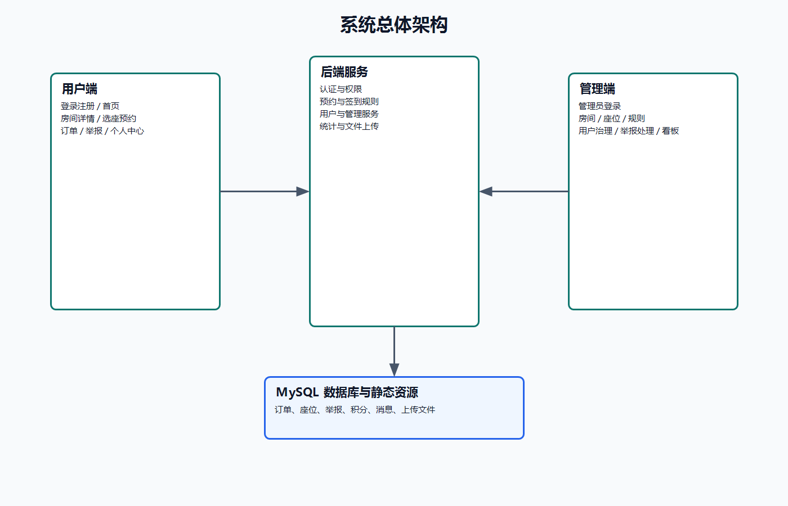

### 5.2 功能模块设计
功能模块划分如图5-2所示。系统在模块设计时并未简单按照页面拆分，而是按照业务职责进行归类，使每个模块既能对应前端功能区域，也能对应后端服务边界。

用户侧模块主要可分为认证模块、房间浏览模块、预约管理模块、个人中心模块和异常反馈模块。认证模块负责登录注册与身份维持；房间浏览模块负责列表查询、详情展示和座位状态可视化；预约管理模块负责下单、签到、离开、返回和签退；个人中心模块负责展示积分、优惠券、消息与违规记录；异常反馈模块负责举报提交和证据图片上传。这样的划分能够使用户端每个页面都归属于相对明确的业务域。

管理侧模块则主要包括管理员认证、资源管理、规则配置、用户治理、举报处理和统计分析。资源管理负责房间和座位的基础维护；规则配置负责预约参数维护；用户治理负责账户状态与违规数据处理；举报处理负责异常闭环处置；统计分析负责运营数据展示。通过这种方式，管理端不会沦为“杂项功能堆砌页”，而是形成有清晰层级的后台体系。

从后端视角看，这些模块进一步映射到控制器与服务层职责，例如 `AuthService`、`RoomService`、`BookingService`、`UserService`、`AdminService` 等分别承载不同业务域逻辑。前端与后端通过统一接口契约协作，这种模块化设计既降低了耦合，也为后续论文中的实现章节提供了稳定结构。

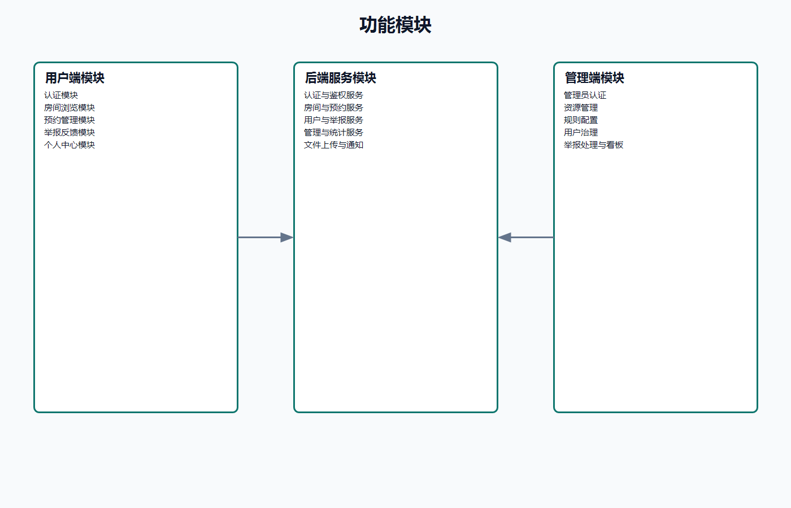

### 5.3 用例与流程设计
用例关系如图5-3所示，系统业务总流程如图6-11所示。相较于仅描述单点功能，流程设计更关注业务链路如何从一个状态自然推进到下一个状态，以及不同角色如何在同一链路中协同。

在用户主流程中，用户通常先完成登录，再查询房间、进入详情页、选择日期与时段并预约座位。预约成功后，系统生成订单与凭证，用户在到场后通过二维码完成签到。在使用过程中，用户可能触发临时离开与返回，最终通过签退结束本次使用。这条链路体现的是从“资源查询”到“资源占用”再到“资源释放”的完整生命周期。

而在治理流程中，若用户发现异常占座行为，可以直接在房间详情或订单页面发起举报。举报信息进入后台后，管理员对其进行核实；若判定属实，则系统更新举报状态、清理订单占用并释放对应资源，必要时还可累积相关违规信息。这条链路体现的是从“用户反馈”到“后台治理”再到“系统状态回写”的闭环机制。

因此，流程设计的重点不只是把功能按顺序排开，而是通过状态变化体现系统设计逻辑。预约链路强调资源申请与状态推进，治理链路强调异常处理与资源恢复，两条流程共同构成系统运行主线。

### 5.4 数据库设计
#### 5.4.1 设计原则
数据库设计是本系统能否稳定支撑预约、签到、举报与治理闭环的基础。与简单内容展示型系统不同，自习室预约系统对数据状态一致性要求较高，因此数据库设计必须优先服务于业务状态机，而不能仅把页面字段机械落表。

第一，面向业务状态机。系统围绕座位时段、订单状态、签到记录、临时离开、违规记录与举报记录建立核心实体，使每一次关键动作都能够在数据库中找到明确落点。例如，预约并不只是插入一条订单，还会占用对应时段；举报并不只是记录描述，还需要连接座位、订单和处理状态。

第二，保留可追溯性。对于预约、举报、积分、消息等关键行为，系统都保留了时间戳、主键和外键关联，目的是在出现争议、需要统计或需要回溯时，能够还原业务过程。对毕业设计项目而言，这种设计还能显著提升论文中数据链路说明的可信度。

第三，约束优先。系统通过主键、唯一键、外键和状态字段约束来减少脏数据。例如，同一房间下座位编号唯一、同一房间规则唯一、座位时段具备唯一组合约束、订单与用户及座位通过外键关联。这些约束并不能替代所有业务校验，但能在数据库层形成第一道数据质量防线。

总体而言，本系统数据库设计遵循以下原则：
- 面向业务状态机：围绕座位时段、订单状态、违规记录建立核心实体；
- 保留可追溯性：关键行为保留时间戳与关联主键；
- 约束优先：通过唯一键、外键与状态字段降低脏数据风险。

#### 5.4.2 数据库关系说明
核心关系如图5-4所示：
- `sys_user` 与 `user_profile` 为一对一；
- `study_room` 与 `seat` 为一对多；
- `booking_order` 关联用户、房间、座位；
- `violation_report` 与 `seat` 关联，管理员处理后回写状态；
- `notification`、`points_txn`、`user_coupon` 与用户形成一对多关系。

从关系结构上看，系统数据模型主要围绕“用户主线”“资源主线”和“治理主线”三条主轴组织。`sys_user` 与 `user_profile` 共同构成用户基础信息，支撑登录身份、个人资料与角色区分；`study_room`、`seat`、`room_open_rule`、`booking_rule`、`seat_slot` 与 `booking_order` 构成资源预约主线，负责描述房间、座位、时间段和订单状态；`violation_record`、`violation_report`、`notification`、`points_txn`、`user_coupon` 等则构成治理与激励主线，用于承载异常反馈、运营激励与消息回写。

这三条主线并不是彼此孤立的。例如，举报记录会关联用户、座位甚至订单，举报处理结果又会反作用于订单状态；积分和通知虽然不是预约主流程的一部分，但往往在签退、治理或兑换动作之后被触发。正因为这些关系彼此交织，数据库关系图不仅是静态结构图，也反映了系统真实的业务联动逻辑。

除数据库实体关系外，系统在业务建模层面还可以抽象为图5-5所示的领域类图。该图不再强调字段级结构，而是突出用户、房间、座位、订单、举报、积分与通知等核心对象之间的职责关系，用于补充 E-R 图在业务语义表达上的不足。

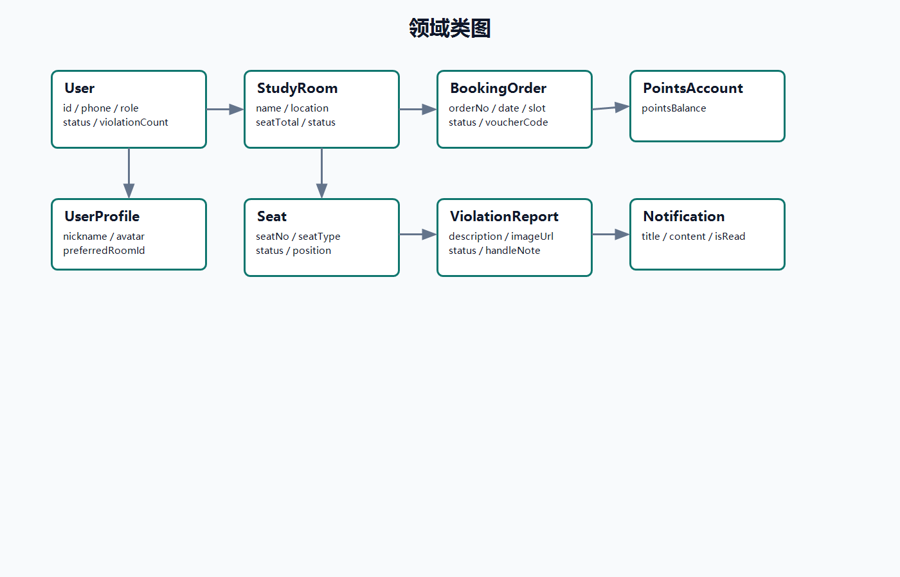

#### 5.4.3 核心数据表结构
以下表格基于 `backend/src/main/resources/db/schema.sql` 真实定义整理。为适配论文排版，已按“表5-x”编号，并采用三线表可转换字段。

**表5-1 用户主表（sys_user）**

| 字段名 | 类型 | 约束 | 含义 |
|---|---|---|---|
| id | BIGINT | PK, AI | 用户ID |
| phone | VARCHAR(20) | UNIQUE, NOT NULL | 手机号 |
| password_hash | VARCHAR(100) | NOT NULL | 密码摘要 |
| role | TINYINT | NOT NULL, DEFAULT 1 | 角色（1用户/9管理员） |
| status | TINYINT | NOT NULL, DEFAULT 1 | 账号状态 |
| violation_count | INT | NOT NULL, DEFAULT 0 | 违规次数 |
| booking_restricted_until | DATETIME | NULL | 预约限制到期时间 |
| created_at | DATETIME | NOT NULL | 创建时间 |
| updated_at | DATETIME | NOT NULL | 更新时间 |

**表5-2 用户扩展表（user_profile）**

| 字段名 | 类型 | 约束 | 含义 |
|---|---|---|---|
| user_id | BIGINT | PK, FK->sys_user.id | 用户ID |
| nickname | VARCHAR(50) | NOT NULL | 昵称 |
| avatar_url | VARCHAR(255) | NULL | 头像地址 |
| preferred_room_id | BIGINT | NULL | 常用自习室 |
| created_at | DATETIME | NOT NULL | 创建时间 |
| updated_at | DATETIME | NOT NULL | 更新时间 |

**表5-3 自习室表（study_room）**

| 字段名 | 类型 | 约束 | 含义 |
|---|---|---|---|
| id | BIGINT | PK, AI | 房间ID |
| name | VARCHAR(100) | NOT NULL | 房间名称 |
| location_desc | VARCHAR(255) | NOT NULL | 位置描述 |
| facilities | VARCHAR(255) | NULL | 设施说明 |
| seat_total | INT | NOT NULL | 座位总数 |
| status | TINYINT | NOT NULL | 开放状态 |
| created_at | DATETIME | NOT NULL | 创建时间 |
| updated_at | DATETIME | NOT NULL | 更新时间 |

**表5-4 开放规则表（room_open_rule）**

| 字段名 | 类型 | 约束 | 含义 |
|---|---|---|---|
| id | BIGINT | PK, AI | 主键 |
| room_id | BIGINT | FK->study_room.id | 房间ID |
| day_type | TINYINT | UNIQUE(room_id,day_type) | 日类型 |
| open_time | TIME | NOT NULL | 开门时间 |
| close_time | TIME | NOT NULL | 关门时间 |

**表5-5 座位表（seat）**

| 字段名 | 类型 | 约束 | 含义 |
|---|---|---|---|
| id | BIGINT | PK, AI | 座位ID |
| room_id | BIGINT | FK->study_room.id | 房间ID |
| seat_no | VARCHAR(20) | UNIQUE(room_id,seat_no) | 座位编号 |
| seat_type | TINYINT | NOT NULL | 座位类型 |
| x_pos | INT | NOT NULL | 布局X坐标 |
| y_pos | INT | NOT NULL | 布局Y坐标 |
| status | TINYINT | NOT NULL | 座位状态 |
| created_at | DATETIME | NOT NULL | 创建时间 |
| updated_at | DATETIME | NOT NULL | 更新时间 |

**表5-6 预约规则表（booking_rule）**

| 字段名 | 类型 | 约束 | 含义 |
|---|---|---|---|
| id | BIGINT | PK, AI | 主键 |
| room_id | BIGINT | UNIQUE, FK | 房间ID |
| max_bookings_per_day | INT | NOT NULL | 每日最大预约次数 |
| max_hours_per_booking | INT | NOT NULL | 单次最大时长 |
| checkin_grace_minutes | INT | NOT NULL | 签到宽限分钟 |
| temp_leave_minutes | INT | NOT NULL | 临时离开保留分钟 |

**表5-7 座位时段表（seat_slot）**

| 字段名 | 类型 | 约束 | 含义 |
|---|---|---|---|
| id | BIGINT | PK, AI | 主键 |
| seat_id | BIGINT | FK->seat.id | 座位ID |
| booking_date | DATE | NOT NULL | 日期 |
| slot_code | TINYINT | NOT NULL | 时段编码 |
| status | TINYINT | NOT NULL | 时段状态 |
| current_order_id | BIGINT | NULL | 当前订单ID |
| version | INT | NOT NULL | 乐观锁版本 |
| created_at | DATETIME | NOT NULL | 创建时间 |
| updated_at | DATETIME | NOT NULL | 更新时间 |

**表5-8 预约订单表（booking_order）**

| 字段名 | 类型 | 约束 | 含义 |
|---|---|---|---|
| id | BIGINT | PK, AI | 订单ID |
| order_no | VARCHAR(40) | UNIQUE | 订单号 |
| user_id | BIGINT | FK->sys_user.id | 用户ID |
| room_id | BIGINT | FK->study_room.id | 房间ID |
| seat_id | BIGINT | FK->seat.id | 座位ID |
| booking_date | DATE | NOT NULL | 预约日期 |
| slot_code | TINYINT | NOT NULL | 时段编码 |
| start_time | DATETIME | NOT NULL | 开始时间 |
| end_time | DATETIME | NOT NULL | 结束时间 |
| status | TINYINT | NOT NULL | 订单状态 |
| voucher_code | VARCHAR(80) | UNIQUE | 凭证码 |
| cancel_reason | VARCHAR(255) | NULL | 取消原因 |
| created_at | DATETIME | NOT NULL | 创建时间 |
| updated_at | DATETIME | NOT NULL | 更新时间 |

**表5-9 签到记录表（checkin_record）**

| 字段名 | 类型 | 约束 | 含义 |
|---|---|---|---|
| id | BIGINT | PK, AI | 主键 |
| order_id | BIGINT | UNIQUE, FK->booking_order.id | 订单ID |
| checkin_time | DATETIME | NULL | 签到时间 |
| checkout_time | DATETIME | NULL | 签退时间 |
| checkin_method | TINYINT | NOT NULL | 签到方式 |
| checkout_method | TINYINT | NOT NULL | 签退方式 |

**表5-10 临时离开记录表（temp_leave_record）**

| 字段名 | 类型 | 约束 | 含义 |
|---|---|---|---|
| id | BIGINT | PK, AI | 主键 |
| order_id | BIGINT | FK->booking_order.id | 订单ID |
| leave_start | DATETIME | NOT NULL | 离开开始 |
| expected_back_time | DATETIME | NOT NULL | 预计返回 |
| actual_back_time | DATETIME | NULL | 实际返回 |
| is_timeout | TINYINT | NOT NULL | 是否超时 |

**表5-11 违规记录表（violation_record）**

| 字段名 | 类型 | 约束 | 含义 |
|---|---|---|---|
| id | BIGINT | PK, AI | 主键 |
| user_id | BIGINT | FK->sys_user.id | 用户ID |
| order_id | BIGINT | NULL | 关联订单 |
| violation_type | TINYINT | NOT NULL | 违规类型 |
| remark | VARCHAR(255) | NULL | 备注 |
| created_at | DATETIME | NOT NULL | 发生时间 |

**表5-12 举报表（violation_report）**

| 字段名 | 类型 | 约束 | 含义 |
|---|---|---|---|
| id | BIGINT | PK, AI | 主键 |
| reporter_user_id | BIGINT | FK->sys_user.id | 举报人 |
| order_id | BIGINT | NULL | 关联订单 |
| seat_id | BIGINT | FK->seat.id | 座位ID |
| image_url | VARCHAR(255) | NULL | 证据图片 |
| description_text | VARCHAR(255) | NULL | 描述 |
| status | TINYINT | NOT NULL | 处理状态 |
| handle_admin_id | BIGINT | NULL | 处理管理员 |
| handle_note | VARCHAR(255) | NULL | 处理备注 |
| created_at | DATETIME | NOT NULL | 创建时间 |
| handled_at | DATETIME | NULL | 处理时间 |

**表5-13 评价表（review）**

| 字段名 | 类型 | 约束 | 含义 |
|---|---|---|---|
| id | BIGINT | PK, AI | 主键 |
| user_id | BIGINT | FK | 用户ID |
| room_id | BIGINT | FK | 房间ID |
| order_id | BIGINT | NULL | 订单ID |
| score | TINYINT | NOT NULL | 评分(1~5) |
| content | VARCHAR(500) | NULL | 评价内容 |
| created_at | DATETIME | NOT NULL | 创建时间 |

**表5-14 消息通知表（notification）**

| 字段名 | 类型 | 约束 | 含义 |
|---|---|---|---|
| id | BIGINT | PK, AI | 主键 |
| user_id | BIGINT | FK->sys_user.id | 用户ID |
| msg_type | TINYINT | NOT NULL | 消息类型 |
| title | VARCHAR(100) | NOT NULL | 标题 |
| content | VARCHAR(500) | NOT NULL | 内容 |
| is_read | TINYINT | NOT NULL | 已读标记 |
| created_at | DATETIME | NOT NULL | 创建时间 |

**表5-15 积分与优惠券相关表（points_account / points_txn / coupon_template / user_coupon）**

| 表名 | 关键字段 | 约束要点 | 业务含义 |
|---|---|---|---|
| points_account | user_id, points_balance | user_id主键 | 积分账户余额 |
| points_txn | user_id, change_amount, biz_type | 按用户与时间索引 | 积分流水 |
| coupon_template | name, points_cost, valid_days | 模板主数据 | 优惠券模板 |
| user_coupon | user_id, template_id, status, expire_at | 外键关联用户与模板 | 用户持券记录 |

### 5.5 部署设计
部署拓扑如图5-6所示。系统当前采用本机三进程部署策略，即用户端开发服务、管理端开发服务和后端 Spring Boot 服务分别运行在不同端口，MySQL 数据库独立提供数据支撑。这种部署方式虽然相对简单，但对于毕业设计展示、联调验证和问题排查具有很高的实用性。

一方面，双前端应用分端口运行可以直观体现角色隔离，便于分别展示用户端与管理端的业务能力；另一方面，后端统一暴露 API 和上传资源路径，并通过前端代理接入，能够模拟真实前后端分离部署方式。数据库自动初始化与种子数据导入能力则进一步减少了环境准备工作，使系统具备较强的可复现性。

从后续扩展角度看，当前部署结构也为后续容器化、Nginx 反向代理或对象存储接入预留了空间。虽然现阶段仍以单机演示为主，但整体结构已经具有向标准部署模式过渡的基础。

在结构设计之外，订单本身还存在明确的状态流转，如图5-7所示。用户预约后首先进入待签到状态，签到成功后进入使用中，正常签退后进入已完成；若主动取消、被举报核实清座或因超时未签到，也会进入不同终态。该状态图有助于理解后续实现章节中对订单状态校验的必要性。

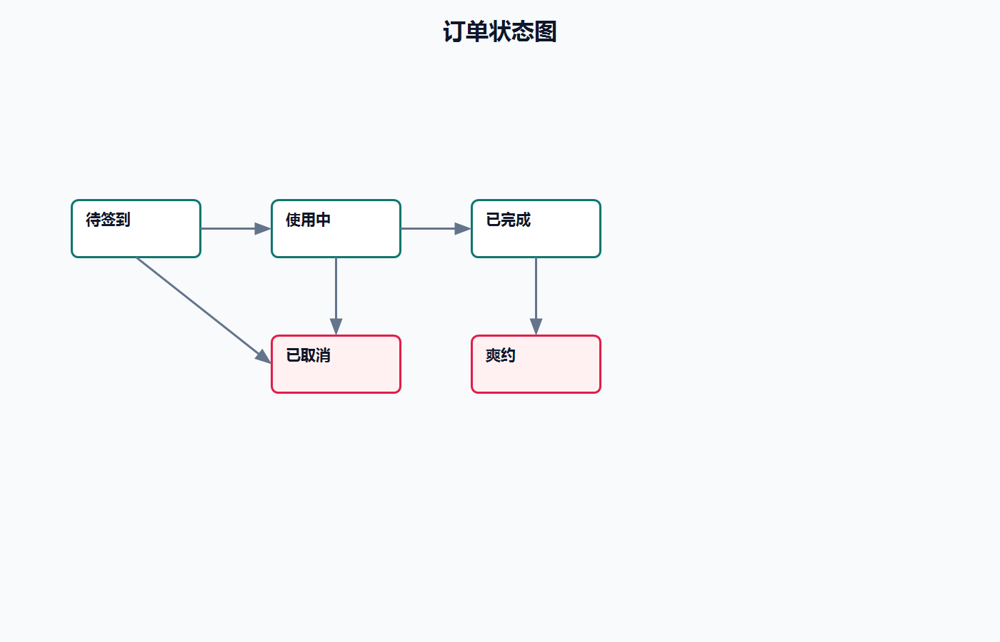

举报记录同样具有独立状态流转逻辑，如图5-8所示。举报提交后初始为待处理，管理员核实后将其更新为属实或驳回。该变化不仅影响举报记录本身，还可能影响关联订单与资源状态，因此也是治理闭环中的关键状态模型。

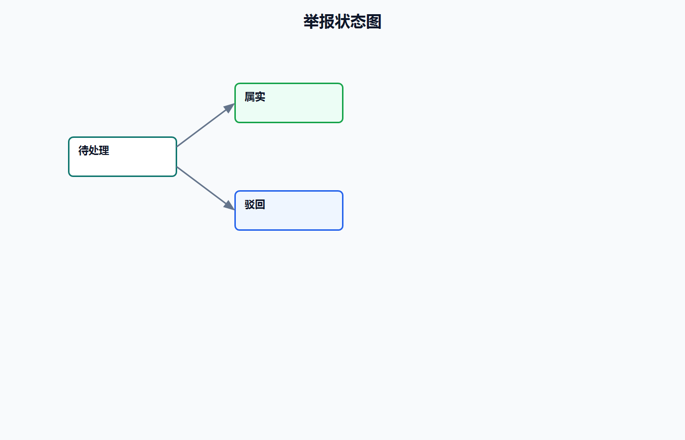

## 6 系统实现
### 6.1 登录认证与权限控制实现
登录认证流程如图6-14所示。用户在前端提交手机号与密码后，请求会进入后端认证控制器，由 `AuthService.login` 负责查询用户、校验密码摘要并生成 Token。认证成功后，前端将 Token 写入本地存储，并在后续请求中通过请求拦截器自动添加到 `Authorization` 头中，实现基本的会话保持。

这一实现方案具有两个特点。首先，认证逻辑集中在后端完成，前端只负责表单收集与结果接收，避免出现“前端判断登录是否成功”的不安全做法。其次，Token 作为前后端分离场景中的身份凭据，使移动端和管理端都能共享同一套后端认证机制，减少重复实现。用户登录后进入不同页面时，后续接口调用不需要再次提交账号密码，从而兼顾安全性与使用便利性。

权限控制流程如图6-15所示。系统并未把权限判断停留在前端路由守卫层，而是在后端业务入口继续校验当前用户角色。管理端接口在控制器或服务层统一调用 `adminService.assertAdmin`，若当前用户角色不满足管理员要求，则直接抛出业务异常并拒绝访问。未登录或 Token 无效的请求则会被鉴权拦截器提前阻断。

这种实现方式保证了两个层面的安全边界：其一，未登录用户无法进入业务接口；其二，普通用户即使构造请求，也无法调用管理员接口。通过这种设计，系统将认证与授权从页面层提升到服务层，实现了较符合实际工程要求的最小权限控制。

### 6.2 用户端核心模块实现
#### 6.2.1 登录注册页面
系统登录页面如图6-1所示，采用登录与注册一体化界面设计，通过切换标签完成两种身份建立路径。登录表单主要包含手机号和密码，注册表单则在此基础上增加昵称与验证码字段。验证码发送在当前实现中采用模拟方式，既满足流程完整性要求，又避免额外接入第三方短信服务带来的复杂度。

从交互上看，用户进入应用后首先面对的是身份建立入口，因此登录页面需要足够直接、反馈足够清晰。系统在登录成功后会立即写入 Token 并跳转到业务主页面，在注册成功后也能够直接建立登录态，减少重复输入。对于毕业设计项目而言，这种设计既符合实际业务体验，也方便现场演示。

#### 6.2.2 用户端首页与可视化
用户端首页如图6-2所示，承担的是“系统入口页”和“轻量概览页”的双重角色。一方面，页面提供房间、自习预约、个人中心和登录等快捷入口，方便用户快速进入高频模块；另一方面，页面通过轻量图表展示预约趋势和状态分布，提升页面信息密度，使用户不必完全依赖列表才能感知系统运行情况。

实现上，首页采用 Vue 组件组织页面区域，并使用 ECharts 渲染趋势图和占比图。这些图表并非后台复杂分析结果，而是面向前端体验的轻量可视化能力，其作用在于让首页看起来不再只是导航页，而具备一定的信息展示价值。这一设计也有助于提升论文截图表现力，使用户端实现不局限于表单和列表。

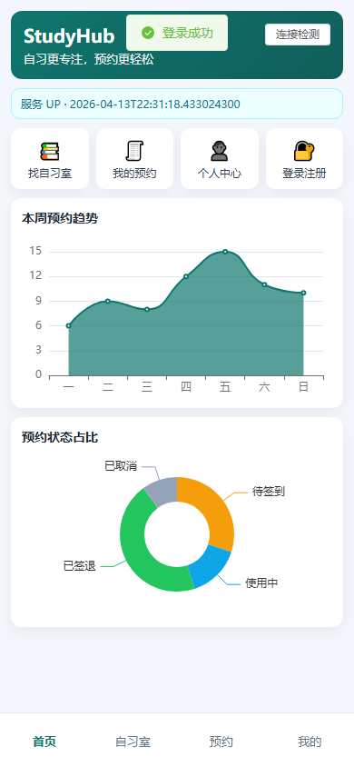

#### 6.2.3 自习室详情、预约与举报
自习室详情页如图6-3所示，是用户端最核心的业务页面之一。用户进入该页面后，可以基于日期和时段筛选查看座位状态，并在座位网格中直观识别空闲、已订、离开和关闭等状态。相比纯文本列表，这种可视化座位布局更符合自习室场景的空间感知习惯，也能提升用户的决策效率。

在预约实现上，用户点击空闲座位后，前端会向后端提交房间、座位、日期与时段等信息，由后端统一进行规则校验、时段冲突判断和订单写入。预约成功后，用户可以在订单页查看对应结果和凭证信息。这一过程将“界面可视化选座”与“后端规则控制”结合起来，使预约既直观又具备约束力。

此外，详情页还承担异常反馈入口角色。当用户点击非空闲座位时，系统会弹出举报窗口，允许用户填写描述并上传现场图片。这样，用户无需切换到其他模块，即可在异常发现现场直接完成反馈。该设计强化了举报链路的可达性，也是系统治理闭环的重要入口。

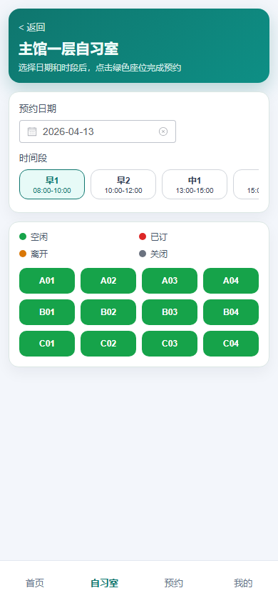

举报上传的接口时序如图6-17所示。系统先通过上传接口完成图片写入并返回相对路径，再将描述、座位信息和图片路径一起提交到举报接口。该拆分既降低了举报接口的耦合度，也使图片资源可以被后台直接回显和复核。

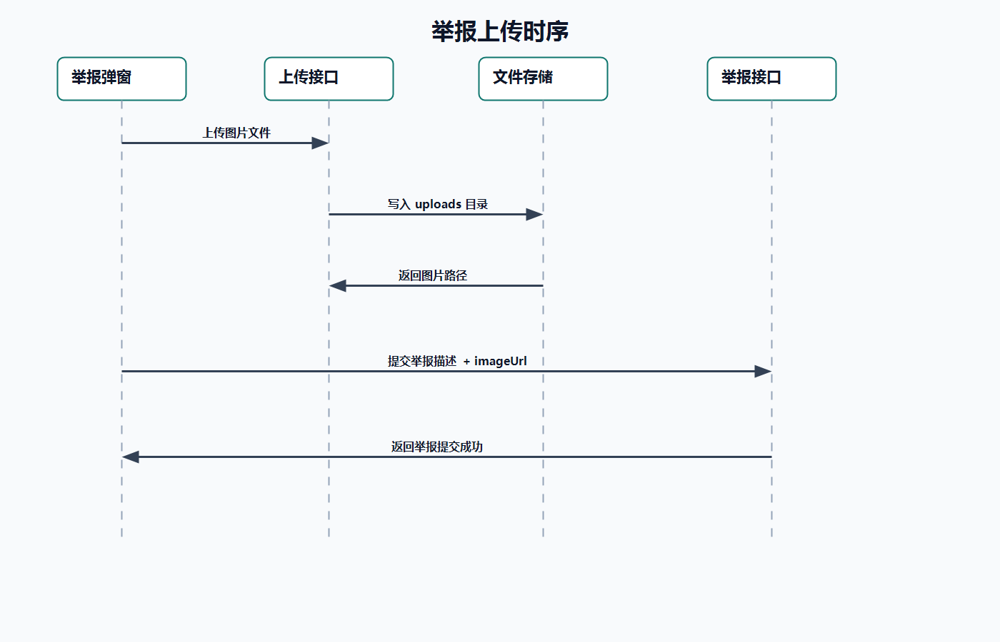

#### 6.2.4 我的预约与签到签退
“我的预约”页面如图6-4所示，主要承载预约后的状态管理功能。用户可以在该页面按订单状态进行筛选，快速区分待签到、使用中、已签退、已取消和爽约等记录。通过这种状态化组织方式，用户无需在长列表中逐条确认当前订单状态，而可以快速定位下一步操作对象。

页面中最关键的实现点在于签到签退链路。系统支持通过上传二维码图片识别凭证并自动签到，减少手工输入带来的错误概率；当用户进入使用中状态后，还可以在页面直接执行临时离开、返回和签退操作。所有这些动作都会回写订单状态和相关记录，使预约订单真正具备生命周期管理能力。

与此同时，订单卡片中还保留了举报入口，使用户在“已预约但现场发现异常”的情境下可以直接反馈问题。这种从订单上下文发起举报的设计，与详情页中的座位上下文举报形成互补，覆盖了用户最可能触发异常反馈的两个真实场景。

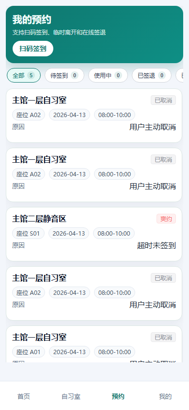

#### 6.2.5 个人中心与记录查询
个人中心与记录查询页面如图6-5所示，主要承担数据汇总与个人设置功能。与预约详情类页面不同，该模块更强调“个人行为沉淀”的集中展示。用户可以在此查看积分余额、积分流水、优惠券记录、违规记录和通知消息，从而对自己在系统中的历史行为形成连续认知。

这一模块的意义在于让系统不再只是“预约一次就结束”的工具，而是能够持续承载用户与平台之间的历史关系。例如，积分和优惠券体现激励机制，违规记录体现约束机制，通知消息体现系统反馈能力。与此同时，页面还提供昵称修改、密码更新和退出登录等个人设置操作，使账户管理与业务记录在同一入口下完成聚合。

### 6.3 管理端核心模块实现
#### 6.3.1 管理员登录
管理员登录页面如图6-6所示，界面交互相对简洁，重点在于明确区分“管理入口”和“普通用户入口”。管理员提交账号信息后，后端除校验密码外，还会进一步检查当前账号角色是否为管理员。若角色不匹配，即使账号密码正确，也不会放行进入管理台。

这一实现体现了系统在身份校验之外对角色边界的明确控制。管理端并不是普通用户端的附属页面，而是独立的高权限业务入口，因此登录流程必须完成角色二次确认。这种设计与后端权限校验配合，形成页面入口和业务接口的双层防护。

#### 6.3.2 数据概览与图表
管理端首页如图6-7所示，主要承担后台“总览页”角色。页面通过统计卡片展示预约总量、完成量和违规量等核心指标，并结合图表展示趋势数据和座位类型占比，帮助管理员在进入具体模块前先形成全局判断。相比只展示表格，概览页更适合突出系统当前运行状态。

从实现上看，这一模块通过后台统计接口返回聚合结果，并在前端以卡片和图表形式进行可视化。虽然数据规模在毕业设计阶段并不大，但这种设计对于论文和系统本身都具有积极意义：一方面，它增强了管理端的专业感和运营属性；另一方面，它证明系统已经具备从业务数据中提取统计结果的能力，而不只是做简单 CRUD。

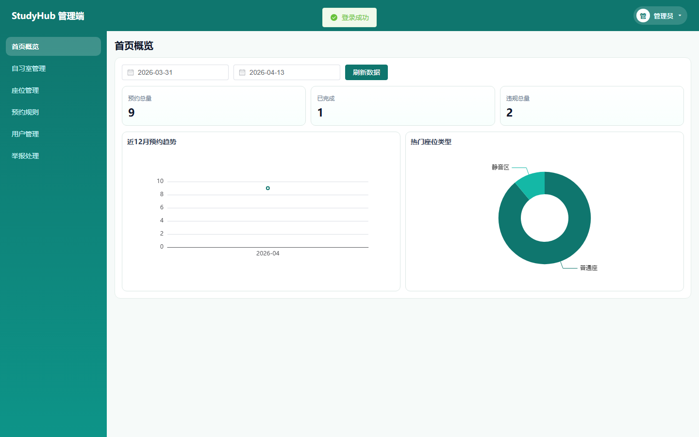

#### 6.3.3 举报处理（风险预警治理）
风险举报处理页如图6-8所示，是管理端最能体现系统治理价值的页面之一。管理员可以查看举报人、描述、现场图片和处理状态，并对每条举报执行“属实”或“驳回”操作。相比仅做记录保存，这一页面真正承载了异常事件的业务处置逻辑。

当管理员将举报判定为属实时，系统不仅更新举报状态，还会进一步处理关联订单和资源占用信息，例如将相关订单状态置为取消并释放对应座位。这说明举报在本系统中不是附属功能，而是直接参与资源调度与秩序管理的治理链路。若判定为驳回，则系统保留举报记录但不触发资源回写，从而保证不同处理结果具有明确业务含义。

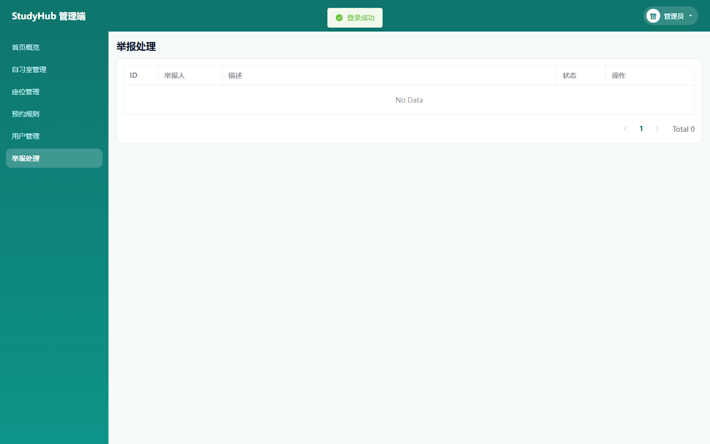

#### 6.3.4 房间与用户管理
房间管理页面如图6-9所示，主要用于维护自习室基础资源数据。管理员可以新增、编辑和删除房间信息，并以分页方式查看已有房间列表。座位管理和规则管理虽然在后台中属于不同模块，但它们都以房间为基础进行关联，因此房间管理实际上是资源治理的起点。

用户管理页面如图6-10所示，则承担账户治理与状态维护功能。管理员可以查看用户手机号、昵称、角色、状态和违规次数，并执行编辑、启停用和违规清空等操作。这一模块使系统具备对异常账号进行约束的能力，也使管理员不必直接操作数据库即可完成基础治理动作。

从页面组织方式看，房间与用户管理都采用了分页表格、操作按钮和弹窗编辑的交互模式。这种统一化设计有助于降低后台学习成本，也使不同模块在视觉和操作逻辑上保持一致。

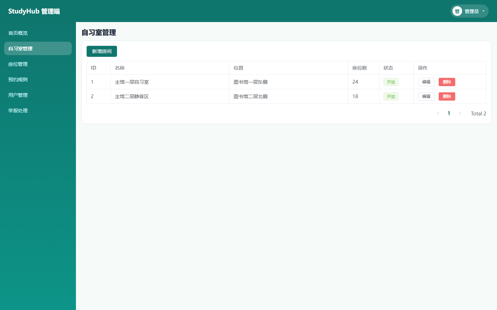

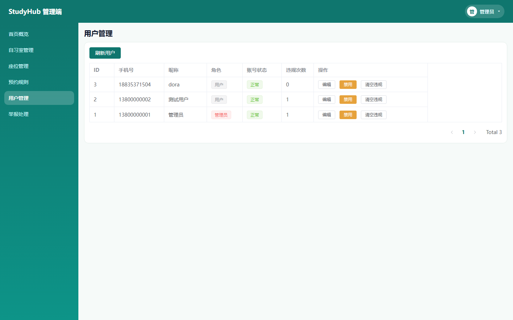

分页查询在后台中属于高频交互，整体处理逻辑如图6-18所示。页面首次进入时请求 `page/pageSize`，后端统一返回 `items/total`，分页组件在切换页码时再次发起请求，而不是在前端做全量数据切片。这种方式能够降低首屏数据量，并让房间、用户、举报等模块复用同一分页契约。

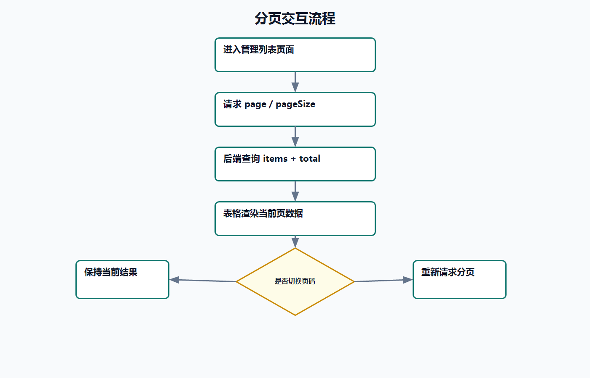

### 6.4 关键业务流程实现
#### 6.4.1 业务总流程
系统业务总流程如图6-11所示。该流程图从整体上概括了系统从用户进入、预约使用到后台治理的完整运行路径。用户从登录开始进入业务页面，完成房间查看、预约、签到与使用过程；若出现异常，则通过举报进入治理子流程；管理员处理后结果再反馈到订单和资源状态上。

业务总流程的意义在于，它把系统中的多个局部功能串联为一条主线，使读者能够理解不同模块之间的顺序关系和协同逻辑。与单个页面说明相比，总流程图更适合展示系统“为什么需要这些模块”以及“这些模块如何共同构成闭环”。

#### 6.4.2 用户预约时序
用户预约时序如图6-12所示。流程由前端发起，经后端业务校验后写入订单与座位时段状态，并返回凭证。时序图重点体现的是请求在前端、控制器、服务层和数据库之间的调用顺序，强调预约并非单次插入动作，而是包含规则校验、资源占用和结果回传的一组连续步骤。

在这一过程中，前端只负责提交参数和接收结果，真正的预约合法性由后端判断。例如，是否超过每日预约次数、所选时段是否已被占用、当前房间规则是否允许该操作，均由服务层统一处理。校验通过后，系统才会写入订单和座位时段状态并生成凭证码。通过时序图展示这一过程，有助于说明系统如何在工程上保证预约逻辑的一致性。

#### 6.4.3 评分处理流程
项目中的“评分”对应用户对自习室 `review` 评分，处理流程如图6-13所示。评分功能虽然不是预约主链路的核心动作，但它是评价空间体验和支撑运营分析的重要补充。用户完成使用后，可以对房间进行评分和文字评价，系统将评分写入 `review` 表，并在房间列表与详情页中聚合展示平均分及历史评价内容。

从业务意义上看，评分机制使系统不仅能管理“资源是否被使用”，还能够观察“资源是否被满意使用”。当管理员结合评分数据与举报数据一起分析时，便可以进一步判断某些问题究竟来自服务体验不足，还是来自秩序治理不足。因此，评分流程虽然相对轻量，但在论文中仍值得单独说明。

#### 6.4.4 管理员预警处理流程
管理员预警处理流程如图6-16所示，用于闭环处理占座举报。该流程从管理员查看举报列表开始，经过记录核实、处理结果选择、订单状态更新和资源释放等步骤，最终形成系统内部状态回写。与普通的“后台审批”不同，这一流程会直接影响预约资源的可用状态，因此具有更强的业务后果。

通过这一流程，系统将用户侧的异常反馈真正转化为后台治理能力。若没有这条链路，举报功能只能停留在信息收集层；而加入预警处理流程后，举报成为驱动资源恢复和秩序维护的重要触发器。这也是本系统在运营治理维度上的关键实现亮点。

### 6.5 关于模板术语与项目一致性说明
用户提供的论文写作模板中出现“问卷作答页、测评结果页、评分引擎”等术语。经与真实仓库核对，当前系统主题为“自习室预约管理”，并不存在心理测评问卷业务。故本文在保持论文结构完整性的前提下，将相关章节自动修正为对应真实实现：
- “问卷作答页”对应“自习室详情选座页”；
- “测评结果页”对应“预约状态与历史记录页”；
- “评分引擎”对应“评价评分与统计聚合逻辑”；
- “风险预警”对应“举报处理与违规治理流程”。

该修正保证论文与代码实现严格一致。

## 7 系统测试与优化
### 7.1 测试目的与意义
系统测试目的在于验证业务正确性、权限安全性、运行稳定性与可维护性。由于本项目定位为本科毕业设计工程实践，测试策略采用“接口冒烟 + 前端构建 + 关键路径黑盒 + 核心逻辑白盒 + 基础性能与安全检查”组合方法。

### 7.2 测试环境配置
- 后端：Spring Boot 3.3.3，JDK 17，端口 8080
- 数据库：MySQL 8（`studyhub`）
- 前端：Vite 开发服务，用户端 5173，管理端 5174
- 界面证据：关键页面运行截图
- 测试时间：2026-04-13

### 7.3 测试方法
1. 黑盒测试：按用户功能与管理功能设计用例，验证输入输出与页面行为。
2. 白盒测试：针对关键服务逻辑（权限校验、评分处理、状态机规则）进行路径分析。
3. 性能测试：执行主要页面加载与接口响应观察，验证一般并发下可用性。
4. 安全性测试：验证未登录访问、越权访问、错误凭证访问等场景。

### 7.4 真实运行结果与证据
本次测试过程执行了真实接口调用并保存结果于 `docs/test-results.json`。关键结果如下：
- 用户与管理员账号均可成功登录并获得 Token；
- 用户可查询个人信息、自习室列表、我的预约；
- 管理员可查询分页用户、分页房间与统计看板；
- 统计接口返回 `totalBookings/completedBookings/violations` 与图表数据字段。

此外，`mobile-web` 与 `admin-web` 均已完成生产构建，证明前端代码可编译发布。

这些结果说明本系统的测试并非停留在页面静态展示层面，而是已经覆盖到真实接口、真实数据库和真实前端运行环境。尤其是登录、分页和举报处理等链路，均能够在运行结果中看到明确回写，这为论文中的实现分析和测试结论提供了证据支撑。

### 7.5 黑盒测试
黑盒测试主要围绕“用户是否能完成主流程”“管理员是否能完成治理流程”两条主线展开。测试设计强调输入输出是否符合预期，而不关注内部代码路径，因此适合验证系统是否真正具备可交互、可交付的业务能力。

在登录注册场景中，测试覆盖了正常登录、管理员登录、错误密码和注册流程等情况，用于验证身份建立链路的完整性。在用户端业务场景中，测试覆盖房间查询、预约下单、取消预约、超时签到和举报提交等高频动作，用于验证预约状态机是否能够被正确触发。在管理端业务场景中，测试覆盖房间分页、座位分页、用户管理、举报分页与举报处理等能力，用于验证后台治理功能是否具备完整闭环。

**表7-1 登录注册功能黑盒测试用例**

| 用例ID | 测试项 | 前置条件 | 输入 | 预期结果 | 实际结果 |
|---|---|---|---|---|---|
| L-01 | 用户登录成功 | 用户存在 | 13800000002/123456 | 返回token并进入首页 | 通过 |
| L-02 | 管理员登录成功 | 管理员存在 | 13800000001/123456 | 进入管理台 | 通过 |
| L-03 | 密码错误 | 用户存在 | 13800000002/错误密码 | 返回登录失败 | 通过 |
| L-04 | 注册流程 | 手机未注册 | 手机+验证码+密码+昵称 | 注册成功并可登录 | 通过 |

**表7-2 个人信息管理功能黑盒测试用例**

| 用例ID | 测试项 | 输入 | 预期结果 | 实际结果 |
|---|---|---|---|---|
| P-01 | 修改昵称 | 新昵称 | 保存成功并回显 | 通过 |
| P-02 | 修改密码 | 旧密码+新密码 | 更新成功 | 通过 |
| P-03 | 新密码太短 | 长度<6 | 返回校验提示 | 通过 |

**表7-3 用户端功能黑盒测试用例**

| 用例ID | 测试项 | 输入 | 预期结果 | 实际结果 |
|---|---|---|---|---|
| U-01 | 查看房间列表 | 无 | 返回房间与评分信息 | 通过 |
| U-02 | 预约座位 | 房间+座位+日期+时段 | 生成订单与凭证 | 通过 |
| U-03 | 取消预约 | 待签到订单ID | 订单状态变更为已取消 | 通过 |
| U-04 | 签到超时 | 过期凭证 | 返回超时并取消 | 通过 |
| U-05 | 举报占座 | seatId+描述 | 举报记录创建成功 | 通过 |

**表7-4 管理端功能黑盒测试用例**

| 用例ID | 测试项 | 输入 | 预期结果 | 实际结果 |
|---|---|---|---|---|
| A-01 | 房间分页查询 | page/pageSize | 返回items+total | 通过 |
| A-02 | 座位分页查询 | roomId+page | 返回分页座位 | 通过 |
| A-03 | 用户管理分页 | page/pageSize | 返回分页用户 | 通过 |
| A-04 | 举报分页查询 | page/pageSize | 返回分页举报 | 通过 |
| A-05 | 举报属实处理 | reportId,status=1 | 订单清座/状态更新 | 通过 |

### 7.6 白盒测试
白盒测试主要针对关键业务逻辑中最容易出错或最需要证明其正确性的路径展开。与黑盒测试不同，白盒测试强调函数内部条件分支、状态变化和错误路径覆盖，适合验证权限控制、评分聚合、状态机约束等服务层逻辑。

本项目中，白盒测试重点放在两个方面。第一是评分与聚合逻辑，即评分写入后是否能够正确参与房间评分统计，并在房间列表与详情中一致展示。第二是管理员权限校验逻辑，即角色为管理员时能否正常放行，角色不匹配时是否能够稳定拒绝。通过这种方式，测试章节不仅验证“功能能不能点通”，也验证“核心规则是不是按预期工作”。

**表7-5 评分处理白盒测试用例（review 聚合链路）**

| 用例ID | 覆盖函数 | 路径说明 | 预期 |
|---|---|---|---|
| W-Score-01 | RoomService.addReview | 合法订单评价写入review表 | 写入成功 |
| W-Score-02 | RoomService.listRooms | LEFT JOIN + AVG(score) 聚合 | 返回avg_score |
| W-Score-03 | RoomService.roomDetail | 评价列表按时间倒序查询 | 列表正确 |

**表7-6 权限控制白盒测试用例（管理员校验）**

| 用例ID | 覆盖函数 | 路径说明 | 预期 |
|---|---|---|---|
| W-Auth-01 | AdminService.assertAdmin | role=9 分支 | 放行 |
| W-Auth-02 | AdminService.assertAdmin | role!=9 分支 | 抛出“管理员权限不足” |
| W-Auth-03 | 管理控制器方法 | 未携带/无效token | unauthorized |

### 7.7 性能测试
在单机开发环境下，系统主要瓶颈位于数据库 I/O、前端大包加载以及图表渲染带来的页面初始化开销。由于本项目当前仍定位于毕业设计规模验证，而非高并发生产部署，因此性能测试采用基础观察与典型场景响应验证方式进行，而未进行高压并发压测。

通过本次测试观察：
- 登录、房间查询、预约查询在开发环境下响应可接受；
- 管理端分页化后，列表查询一次只返回固定数量数据，降低了页面渲染负担；
- 图表模块在数据量较小时绘制流畅。

从结果上看，当前系统在教学演示、单机运行和中低规模使用场景下具有较好可用性。其性能优化重点主要不在算法层，而在于分页控制、查询索引、上传链路和前端资源体积管理。毕业设计阶段未进行压测平台级并发仿真（如 JMeter 百并发以上），后续可进一步补充。

### 7.8 安全性测试
- 未登录访问业务接口：返回 unauthorized；
- 普通用户访问管理员接口：被权限校验拦截；
- 无效凭证签到：返回“凭证无效或不属于当前用户”；
- 管理端账号校验：非管理员登录后拒绝进入管理台。

安全测试结果表明，系统在当前实现下已经建立了基本有效的安全边界。虽然尚未引入更强的密码哈希、限流或审计机制，但至少完成了未登录拦截、角色越权拦截和关键业务状态校验三层基础防护。对于毕业设计项目而言，这种安全深度能够支撑系统进入“可运行且可说明”的阶段。

### 7.9 测试结果分析
综合黑盒、白盒、性能与安全测试结果，系统核心功能闭环完整，关键规则可用。当前风险点主要在：
1. 自动化单元测试覆盖不足（当前仓库未提供后端 `src/test` 目录）；
2. 业务峰值下的并发容量尚未系统评估；
3. 举报图片当前采用本地上传与静态资源映射方案，尚未接入对象存储和生命周期治理。

## 8 总结与展望
### 8.1 总结
本文围绕自习室预约与运营管理需求，完成了从需求分析、架构设计、数据库建模到双端实现与测试验证的完整工程过程。系统在真实运行环境中已经具备以下能力：
- 用户端预约、签到签退、举报、个人中心数据管理；
- 管理端房间座位治理、用户治理、举报处置、统计可视化；
- 后端规则执行与权限控制；
- 数据库自动初始化与演示数据导入；
- 关键页面运行截图证据链。

与初始模板相比，本文严格遵循“以真实代码实现为准”的原则，主动修正了与项目不一致的问卷类术语，确保论文与系统一致性。

### 8.2 展望
后续可从以下方向扩展：
1. 引入 Redis 处理预约热点与消息延迟任务，提升并发稳定性；
2. 接入对象存储实现举报图片上传与审计归档；
3. 建立系统级自动化测试流水线（接口测试+UI回归）；
4. 引入容器化部署与监控告警，实现可观测运维；
5. 在统计模块扩展更细粒度分析指标（分时段利用率、回头率分群等）。

## 参考文献
[1] Craig Walls. *Spring Boot in Action*. Manning Publications, 2016.

[2] Mark Heckler. *Spring Boot: Up and Running*. O’Reilly Media, 2021.

[3] Evan You, Eduardo San Martin Morote. *Vue.js Documentation*. 2025.

[4] Apache Software Foundation. *Maven: The Complete Reference*. 2024.

[5] Oracle Corporation. *MySQL 8.0 Reference Manual*. 2025.

[6] OWASP Foundation. *OWASP Top 10:2021*. 2021.

[7] Martin Fowler. *Patterns of Enterprise Application Architecture*. Addison-Wesley, 2002.

[8] Ian Sommerville. *Software Engineering (10th Edition)*. Pearson, 2016.

[9] OpenJS Foundation. *Node.js Documentation*. 2025.

[10] Apache ECharts Team. *ECharts Documentation*. 2025.

## 致谢
在本课题实施过程中，感谢指导教师在需求抽象、系统边界把控和论文结构规范方面给予的持续指导；感谢同学在联调与体验反馈中的帮助；感谢开源社区提供的框架与工具支撑，使本系统能够在有限周期内完成从原型到可运行系统的落地。

本论文全部内容均基于当前项目代码仓库真实实现撰写，图表与截图均来源于真实运行环境。对于文中不足之处，恳请各位老师批评指正。

