# 自习室在线预约与管理系统设计与实现

## 摘要
随着高校图书馆与共享学习空间的使用规模持续扩大，传统“先到先得”的座位占用方式在高峰时段暴露出明显局限：一方面，使用者难以及时获知空闲资源分布，导致线下排队与无效寻找成本上升；另一方面，管理者对违规占座、签到超时、临时离开超时等行为缺少实时治理能力，导致资源利用率与服务满意度下降。针对上述问题，本文以“自习室在线预约与管理系统”为研究对象，结合移动端预约场景与后台运营治理场景，完成了一套前后端分离的业务系统设计与实现。

本系统以 Spring Boot 3.3.3 作为服务端核心框架，采用 JDBC 直接访问 MySQL 8 数据库，围绕认证授权、房间座位管理、预约与签到签退、违规与举报处理、积分优惠券、通知提醒、统计分析等业务域展开模块化实现；前端采用 Vue 3 + Vite + Element Plus 技术栈，分别构建用户移动端（mobile-web）与管理端（admin-web），实现“角色分离、界面分离、职责分离”的双端协同。在安全控制方面，系统以 Token 机制承载身份凭据，并在管理接口中通过 `assertAdmin` 完成角色校验；在数据初始化方面，系统通过启动自检实现“数据库不存在时自动建库建表与种子数据导入”，降低部署门槛。在工程层面，系统已形成真实可运行的三层部署结构：5173 用户端、5174 管理端、8080 后端 API。

论文工作重点包括：其一，基于真实代码仓库进行需求归纳与领域建模，构建覆盖用户侧与运营侧的完整业务闭环；其二，完成数据库逻辑结构设计，明确核心数据实体、外键关系与约束策略；其三，实现预约时段控制、签到超时判定、临时离开回座、举报核实清座、积分奖励等关键规则；其四，在测试章节中结合真实运行环境、接口调用结果、前端构建结果与自动化截图证据，对功能正确性、权限安全性与可运维性进行验证。

本文研究表明：该系统在真实运行条件下能够支撑自习室预约管理核心流程，具备较好的可扩展性与可维护性。后续可进一步引入 Redis 消息队列、对象存储、容器化部署及更完善的自动化测试体系，以提升高并发场景下的性能表现与工程鲁棒性。

**关键词**：自习室预约；Spring Boot；Vue 3；前后端分离；权限控制；管理信息系统

## Abstract
With the rapid growth of shared study spaces in universities, the traditional first-come-first-served seat usage model faces significant limitations during peak hours. Users cannot efficiently identify available seats, while operators lack real-time governance for no-show check-ins, temporary leave timeout, and illegal seat occupation. To address these issues, this thesis designs and implements an Online Study Room Reservation and Management System, targeting both mobile user-side reservation workflows and administrator-side operation workflows.

The backend is implemented with Spring Boot 3.3.3 and MySQL 8 through JDBC-based data access. The system covers major business domains including authentication, room and seat management, reservation and check-in/check-out, violation and report handling, points and coupons, notification service, and dashboard statistics. The frontend adopts Vue 3 + Vite + Element Plus and is split into two independent applications: a mobile-oriented user client and an administrator client. Security is enforced through token-based authentication and role-based authorization checks in administrative services. To improve deployability, the system supports automatic database initialization by detecting schema existence at startup and importing schema and seed data when necessary.

This thesis is strictly aligned with the real repository implementation. It includes requirements analysis, architecture design, database schema design, module implementation, and test verification based on actual interfaces, actual source code, and actual runtime evidence. The implementation demonstrates that the system can stably support core reservation-management scenarios with clear module boundaries and maintainable engineering structure. Future work may include Redis-based scheduling optimization, object storage integration, containerized deployment, and broader automated testing.

**Keywords**: study room reservation; Spring Boot; Vue 3; front-end/back-end separation; access control; management information system

---

## 1 绪论
### 1.1 研究背景
高校学习空间的数字化管理正在从“静态信息发布”向“动态资源调度”演进。对于自习室场景而言，资源管理难点并不在于座位数量本身，而在于“时空维度下的可用性变化”：同一座位在不同日期、不同时间段、不同状态（空闲、已预订、临时离开、关闭）下具备不同可用性。若仅依赖人工巡查与线下占座，系统将难以形成可追踪、可统计、可治理的运营闭环。

从管理信息系统的角度看，自习室业务具备典型的“多角色、多状态、多规则”特征。用户侧关注的是预约成功率、签到便利性与消息可达性；管理侧关注的是房间利用率、违规行为分布、规则生效情况与服务质量提升路径。二者需要在统一数据模型下协同运作，促使系统同时满足“业务可用性”与“管理可控性”。

### 1.2 研究意义
本课题的实践价值主要体现在三个层面。
1. 在用户体验层面，通过可视化选座、分时段预约、二维码签到签退与个人中心记录查询，显著降低用户的时间成本与操作复杂度。
2. 在运营治理层面，通过举报受理、违规累计限制、规则参数化配置与统计看板，提升管理者对异常行为与资源效率的治理能力。
3. 在工程实现层面，通过前后端分离架构、双端独立部署、统一 API 语义与自动建库机制，为校园类轻量管理系统提供可复用实现范式。

### 1.3 国内外相关研究与现状
在国外共享办公与图书馆预约系统中，较成熟方案通常强调实时可视化、规则可配置和数据可分析；国内校园场景产品更关注移动端入口、低学习成本与本地化管理流程。对比现有实践可见，部分系统在“预约”维度已较完整，但“签到约束、违规治理、运营看板”往往实现不足，导致管理端价值未被充分释放。

本文项目的差异化在于：不仅实现用户预约流程，还将违规治理、积分激励、管理员多模块联动纳入同一业务闭环，并提供分页化后台查询与图表化统计展示，使系统从“预约工具”升级为“运营管理平台”。

### 1.4 研究内容与论文结构
本文围绕真实项目实现展开，核心研究内容包括：
1. 建立双端协同的业务需求模型。
2. 设计并实现符合业务约束的数据库结构。
3. 完成用户端与管理端关键模块开发。
4. 基于真实运行结果进行功能、白盒、性能与安全测试分析。

全文结构如下：第2章介绍开发工具与相关技术；第3章进行可行性分析；第4章展开需求分析；第5章给出系统总体设计与数据库设计；第6章阐述系统实现细节；第7章完成系统测试与优化分析；第8章总结全文并提出后续展望。

## 2 开发工具及相关技术介绍
### 2.1 开发环境与工具链
本系统开发与运行环境如下：
- 操作系统：Windows（开发机环境）
- JDK：17（Spring Boot 3.x 推荐版本）
- 构建工具：Maven（后端）、npm（前端）
- 数据库：MySQL 8
- 版本控制：Git
- 文档导出：Pandoc
- 自动化截图：Playwright + Chromium

### 2.2 后端关键技术
#### 2.2.1 Spring Boot 3
项目后端基于 Spring Boot 3.3.3，采用 `spring-boot-starter-web` 构建 REST API。控制层负责请求路由与参数接收，服务层负责业务规则与事务处理，形成清晰分层。

#### 2.2.2 JDBC 与事务控制
系统使用 `JdbcTemplate` 进行 SQL 访问。相较 ORM，该方式便于在毕业设计阶段直接表达业务 SQL 与约束逻辑，并便于对预约并发更新、状态变更、统计聚合等操作进行细粒度控制。关键路径如预约创建、签到签退、临时离开均通过 `@Transactional` 保证一致性。

#### 2.2.3 认证与权限
系统采用 Token 认证机制。登录成功后由后端签发 Token，前端在请求头携带 `Authorization: Bearer ...`。管理端接口统一调用 `AdminService.assertAdmin` 进行角色验证，实现基于角色的访问控制（RBAC 简化实现）。

### 2.3 前端关键技术
#### 2.3.1 Vue 3 + Vite
用户端与管理端均基于 Vue 3 组合式 API。Vite 负责开发态热更新与生产构建，提升开发效率。

#### 2.3.2 Element Plus 组件体系
系统大量使用 Element Plus 表单、表格、对话框、抽屉、分页、标签等组件，保证交互一致性并降低 UI 实现复杂度。

#### 2.3.3 ECharts 数据可视化
用户端首页与管理端仪表盘引入 ECharts，实现趋势图与占比图展示，使统计数据可视化表达更直观。

### 2.4 部署与代理
前端开发服务器通过 Vite 代理将 `/api` 请求转发至后端 `http://localhost:8080`。双端端口分配如下：
- 用户端：`5173`
- 管理端：`5174`
- 后端：`8080`

## 3 可行性分析
### 3.1 技术可行性
从技术栈匹配度看，Spring Boot + Vue 3 属于成熟稳健组合；JDBC 可满足本项目关系型业务需求；MySQL 对事务一致性、索引检索与聚合统计支持充分；Element Plus 与 ECharts 能够支撑毕业设计阶段的可视化与交互需求。系统已在真实环境中完成联调运行，证明技术方案可行。

### 3.2 经济可行性
系统开发依赖开源技术栈，无商业授权成本。部署硬件需求较低，普通教学服务器即可承载。数据库自动初始化能力降低了运维配置成本，因此整体具备较高经济可行性。

### 3.3 运行可行性
用户端流程遵循“少输入、可视化、一步到位”的原则，管理端采用侧边栏模块化入口与列表化治理界面，学习成本可控。系统提供演示账号与初始化数据，便于快速启动、教学展示与验收。

### 3.4 安全可行性
系统具备基础安全控制：
- 登录后方可访问业务接口；
- 管理接口强制管理员角色；
- 关键行为具备服务端状态校验（如签到状态判定、预约状态机约束）；
- 密码采用 SHA-256 摘要存储。

在毕业设计范围内可满足基本安全要求。后续可引入更严格密码哈希（如 BCrypt）与细粒度审计日志。

## 4 需求分析
### 4.1 业务场景与角色
系统包含两类核心角色：
1. 普通用户：完成注册登录、查看自习室、预约选座、签到签退、查看积分与优惠券、提交举报。
2. 管理员：维护房间与座位、配置预约规则、处理举报、管理用户状态、查看统计图表。

### 4.2 功能需求
#### 4.2.1 用户端功能需求
- 登录注册与身份保持；
- 自习室列表与详情展示；
- 日期/时段选择与可视化座位状态；
- 预约下单与凭证生成；
- 扫码签到、临时离开、签退；
- 举报占座；
- 个人中心数据聚合（积分、优惠券、违规、消息、密码修改）。

#### 4.2.2 管理端功能需求
- 管理员登录与权限控制；
- 自习室与座位增删改；
- 预约规则维护；
- 用户分页管理（编辑、启停用、清空违规）；
- 举报分页处理；
- 统计看板展示预约量、完成量、违规量与热门座位类型。

### 4.3 非功能需求
- 可用性：页面交互需在桌面与移动视图中保持基本可用；
- 一致性：预约状态变化需在订单与座位时段表中保持一致；
- 可维护性：前后端模块划分明确，接口语义稳定；
- 可部署性：支持数据库自动初始化与演示数据导入。

### 4.4 用例分析
系统用例关系如图5-3所示。用户与管理员分别驱动不同业务子系统，但在“举报-处理”“违规-限制”等链路上形成协同。

## 5 系统总体设计
### 5.1 总体架构设计
系统总体架构如图5-1所示。前端采用双应用分离部署：移动端负责预约服务流程，管理端负责运营治理流程；后端统一提供 `/api/v1` 风格接口并承载鉴权、规则引擎与数据访问；数据库承担业务状态持久化与统计基础。

### 5.2 功能模块设计
功能模块划分如图5-2所示。为避免模块耦合，系统将“预约流程”“用户中心”“管理治理”进行职责隔离，前后端通过统一接口契约协作。

### 5.3 用例与流程设计
用例关系如图5-3所示，系统业务总流程如图6-11所示。流程重点在于：预约后状态变更、签到超时处理、举报处置闭环。

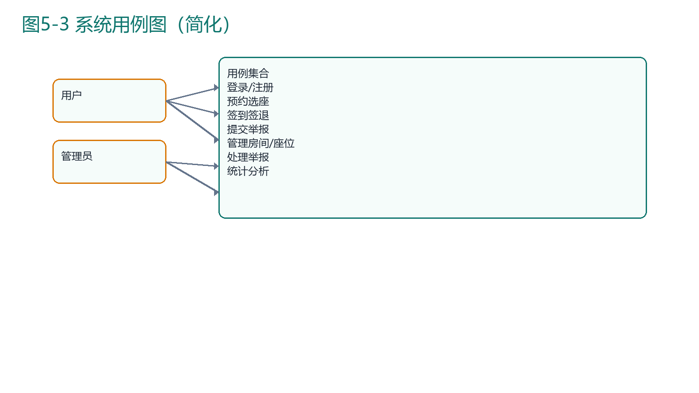

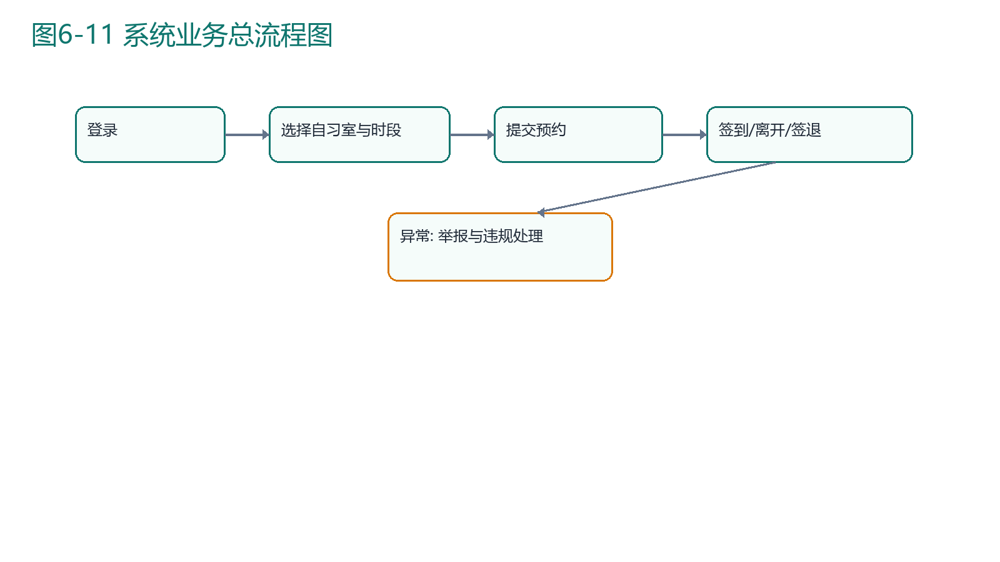

### 5.4 数据库设计
#### 5.4.1 设计原则
- 面向业务状态机：围绕座位时段、订单状态、违规记录建立核心实体；
- 保留可追溯性：关键行为保留时间戳与关联主键；
- 约束优先：通过唯一键、外键与状态字段降低脏数据风险。

#### 5.4.2 数据库关系说明
核心关系如图5-4所示：
- `sys_user` 与 `user_profile` 为一对一；
- `study_room` 与 `seat` 为一对多；
- `booking_order` 关联用户、房间、座位；
- `violation_report` 与 `seat` 关联，管理员处理后回写状态；
- `notification`、`points_txn`、`user_coupon` 与用户形成一对多关系。

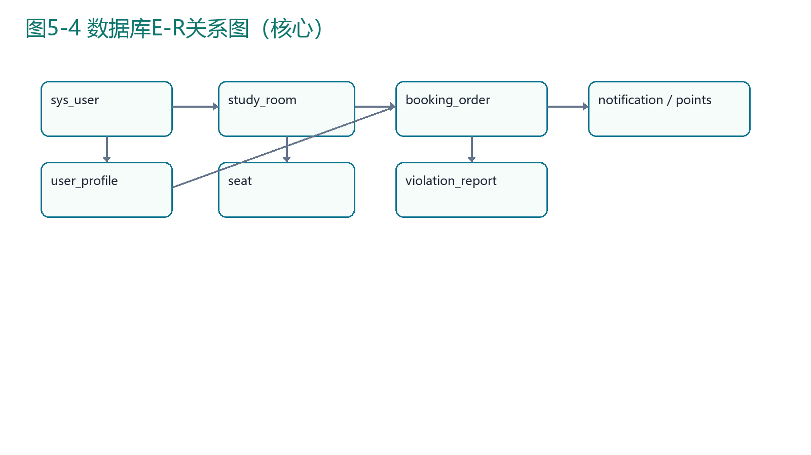

#### 5.4.3 核心数据表结构
以下表格基于 `backend/src/main/resources/db/schema.sql` 真实定义整理。为适配论文排版，已按“表5-x”编号，并采用三线表可转换字段。

**表5-1 用户主表（sys_user）**

| 字段名 | 类型 | 约束 | 含义 |
|---|---|---|---|
| id | BIGINT | PK, AI | 用户ID |
| phone | VARCHAR(20) | UNIQUE, NOT NULL | 手机号 |
| password_hash | VARCHAR(100) | NOT NULL | 密码摘要 |
| role | TINYINT | NOT NULL, DEFAULT 1 | 角色（1用户/9管理员） |
| status | TINYINT | NOT NULL, DEFAULT 1 | 账号状态 |
| violation_count | INT | NOT NULL, DEFAULT 0 | 违规次数 |
| booking_restricted_until | DATETIME | NULL | 预约限制到期时间 |
| created_at | DATETIME | NOT NULL | 创建时间 |
| updated_at | DATETIME | NOT NULL | 更新时间 |

**表5-2 用户扩展表（user_profile）**

| 字段名 | 类型 | 约束 | 含义 |
|---|---|---|---|
| user_id | BIGINT | PK, FK->sys_user.id | 用户ID |
| nickname | VARCHAR(50) | NOT NULL | 昵称 |
| avatar_url | VARCHAR(255) | NULL | 头像地址 |
| preferred_room_id | BIGINT | NULL | 常用自习室 |
| created_at | DATETIME | NOT NULL | 创建时间 |
| updated_at | DATETIME | NOT NULL | 更新时间 |

**表5-3 自习室表（study_room）**

| 字段名 | 类型 | 约束 | 含义 |
|---|---|---|---|
| id | BIGINT | PK, AI | 房间ID |
| name | VARCHAR(100) | NOT NULL | 房间名称 |
| location_desc | VARCHAR(255) | NOT NULL | 位置描述 |
| facilities | VARCHAR(255) | NULL | 设施说明 |
| seat_total | INT | NOT NULL | 座位总数 |
| status | TINYINT | NOT NULL | 开放状态 |
| created_at | DATETIME | NOT NULL | 创建时间 |
| updated_at | DATETIME | NOT NULL | 更新时间 |

**表5-4 开放规则表（room_open_rule）**

| 字段名 | 类型 | 约束 | 含义 |
|---|---|---|---|
| id | BIGINT | PK, AI | 主键 |
| room_id | BIGINT | FK->study_room.id | 房间ID |
| day_type | TINYINT | UNIQUE(room_id,day_type) | 日类型 |
| open_time | TIME | NOT NULL | 开门时间 |
| close_time | TIME | NOT NULL | 关门时间 |

**表5-5 座位表（seat）**

| 字段名 | 类型 | 约束 | 含义 |
|---|---|---|---|
| id | BIGINT | PK, AI | 座位ID |
| room_id | BIGINT | FK->study_room.id | 房间ID |
| seat_no | VARCHAR(20) | UNIQUE(room_id,seat_no) | 座位编号 |
| seat_type | TINYINT | NOT NULL | 座位类型 |
| x_pos | INT | NOT NULL | 布局X坐标 |
| y_pos | INT | NOT NULL | 布局Y坐标 |
| status | TINYINT | NOT NULL | 座位状态 |
| created_at | DATETIME | NOT NULL | 创建时间 |
| updated_at | DATETIME | NOT NULL | 更新时间 |

**表5-6 预约规则表（booking_rule）**

| 字段名 | 类型 | 约束 | 含义 |
|---|---|---|---|
| id | BIGINT | PK, AI | 主键 |
| room_id | BIGINT | UNIQUE, FK | 房间ID |
| max_bookings_per_day | INT | NOT NULL | 每日最大预约次数 |
| max_hours_per_booking | INT | NOT NULL | 单次最大时长 |
| checkin_grace_minutes | INT | NOT NULL | 签到宽限分钟 |
| temp_leave_minutes | INT | NOT NULL | 临时离开保留分钟 |

**表5-7 座位时段表（seat_slot）**

| 字段名 | 类型 | 约束 | 含义 |
|---|---|---|---|
| id | BIGINT | PK, AI | 主键 |
| seat_id | BIGINT | FK->seat.id | 座位ID |
| booking_date | DATE | NOT NULL | 日期 |
| slot_code | TINYINT | NOT NULL | 时段编码 |
| status | TINYINT | NOT NULL | 时段状态 |
| current_order_id | BIGINT | NULL | 当前订单ID |
| version | INT | NOT NULL | 乐观锁版本 |
| created_at | DATETIME | NOT NULL | 创建时间 |
| updated_at | DATETIME | NOT NULL | 更新时间 |

**表5-8 预约订单表（booking_order）**

| 字段名 | 类型 | 约束 | 含义 |
|---|---|---|---|
| id | BIGINT | PK, AI | 订单ID |
| order_no | VARCHAR(40) | UNIQUE | 订单号 |
| user_id | BIGINT | FK->sys_user.id | 用户ID |
| room_id | BIGINT | FK->study_room.id | 房间ID |
| seat_id | BIGINT | FK->seat.id | 座位ID |
| booking_date | DATE | NOT NULL | 预约日期 |
| slot_code | TINYINT | NOT NULL | 时段编码 |
| start_time | DATETIME | NOT NULL | 开始时间 |
| end_time | DATETIME | NOT NULL | 结束时间 |
| status | TINYINT | NOT NULL | 订单状态 |
| voucher_code | VARCHAR(80) | UNIQUE | 凭证码 |
| cancel_reason | VARCHAR(255) | NULL | 取消原因 |
| created_at | DATETIME | NOT NULL | 创建时间 |
| updated_at | DATETIME | NOT NULL | 更新时间 |

**表5-9 签到记录表（checkin_record）**

| 字段名 | 类型 | 约束 | 含义 |
|---|---|---|---|
| id | BIGINT | PK, AI | 主键 |
| order_id | BIGINT | UNIQUE, FK->booking_order.id | 订单ID |
| checkin_time | DATETIME | NULL | 签到时间 |
| checkout_time | DATETIME | NULL | 签退时间 |
| checkin_method | TINYINT | NOT NULL | 签到方式 |
| checkout_method | TINYINT | NOT NULL | 签退方式 |

**表5-10 临时离开记录表（temp_leave_record）**

| 字段名 | 类型 | 约束 | 含义 |
|---|---|---|---|
| id | BIGINT | PK, AI | 主键 |
| order_id | BIGINT | FK->booking_order.id | 订单ID |
| leave_start | DATETIME | NOT NULL | 离开开始 |
| expected_back_time | DATETIME | NOT NULL | 预计返回 |
| actual_back_time | DATETIME | NULL | 实际返回 |
| is_timeout | TINYINT | NOT NULL | 是否超时 |

**表5-11 违规记录表（violation_record）**

| 字段名 | 类型 | 约束 | 含义 |
|---|---|---|---|
| id | BIGINT | PK, AI | 主键 |
| user_id | BIGINT | FK->sys_user.id | 用户ID |
| order_id | BIGINT | NULL | 关联订单 |
| violation_type | TINYINT | NOT NULL | 违规类型 |
| remark | VARCHAR(255) | NULL | 备注 |
| created_at | DATETIME | NOT NULL | 发生时间 |

**表5-12 举报表（violation_report）**

| 字段名 | 类型 | 约束 | 含义 |
|---|---|---|---|
| id | BIGINT | PK, AI | 主键 |
| reporter_user_id | BIGINT | FK->sys_user.id | 举报人 |
| order_id | BIGINT | NULL | 关联订单 |
| seat_id | BIGINT | FK->seat.id | 座位ID |
| image_url | VARCHAR(255) | NULL | 证据图片 |
| description_text | VARCHAR(255) | NULL | 描述 |
| status | TINYINT | NOT NULL | 处理状态 |
| handle_admin_id | BIGINT | NULL | 处理管理员 |
| handle_note | VARCHAR(255) | NULL | 处理备注 |
| created_at | DATETIME | NOT NULL | 创建时间 |
| handled_at | DATETIME | NULL | 处理时间 |

**表5-13 评价表（review）**

| 字段名 | 类型 | 约束 | 含义 |
|---|---|---|---|
| id | BIGINT | PK, AI | 主键 |
| user_id | BIGINT | FK | 用户ID |
| room_id | BIGINT | FK | 房间ID |
| order_id | BIGINT | NULL | 订单ID |
| score | TINYINT | NOT NULL | 评分(1~5) |
| content | VARCHAR(500) | NULL | 评价内容 |
| created_at | DATETIME | NOT NULL | 创建时间 |

**表5-14 消息通知表（notification）**

| 字段名 | 类型 | 约束 | 含义 |
|---|---|---|---|
| id | BIGINT | PK, AI | 主键 |
| user_id | BIGINT | FK->sys_user.id | 用户ID |
| msg_type | TINYINT | NOT NULL | 消息类型 |
| title | VARCHAR(100) | NOT NULL | 标题 |
| content | VARCHAR(500) | NOT NULL | 内容 |
| is_read | TINYINT | NOT NULL | 已读标记 |
| created_at | DATETIME | NOT NULL | 创建时间 |

**表5-15 积分与优惠券相关表（points_account / points_txn / coupon_template / user_coupon）**

| 表名 | 关键字段 | 约束要点 | 业务含义 |
|---|---|---|---|
| points_account | user_id, points_balance | user_id主键 | 积分账户余额 |
| points_txn | user_id, change_amount, biz_type | 按用户与时间索引 | 积分流水 |
| coupon_template | name, points_cost, valid_days | 模板主数据 | 优惠券模板 |
| user_coupon | user_id, template_id, status, expire_at | 外键关联用户与模板 | 用户持券记录 |

### 5.5 部署设计
部署拓扑如图5-5所示。系统当前采用本机三进程部署策略，满足毕业设计展示场景。

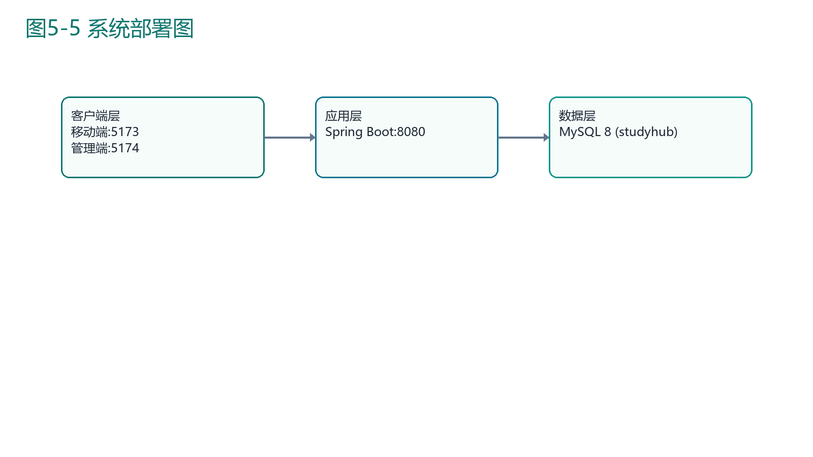

## 6 系统实现
### 6.1 登录认证与权限控制实现
登录认证流程如图6-14所示。用户提交手机号与密码后，后端 `AuthService.login` 校验密码哈希并签发 Token。前端在 axios 请求拦截器中附加 Token，实现后续鉴权。

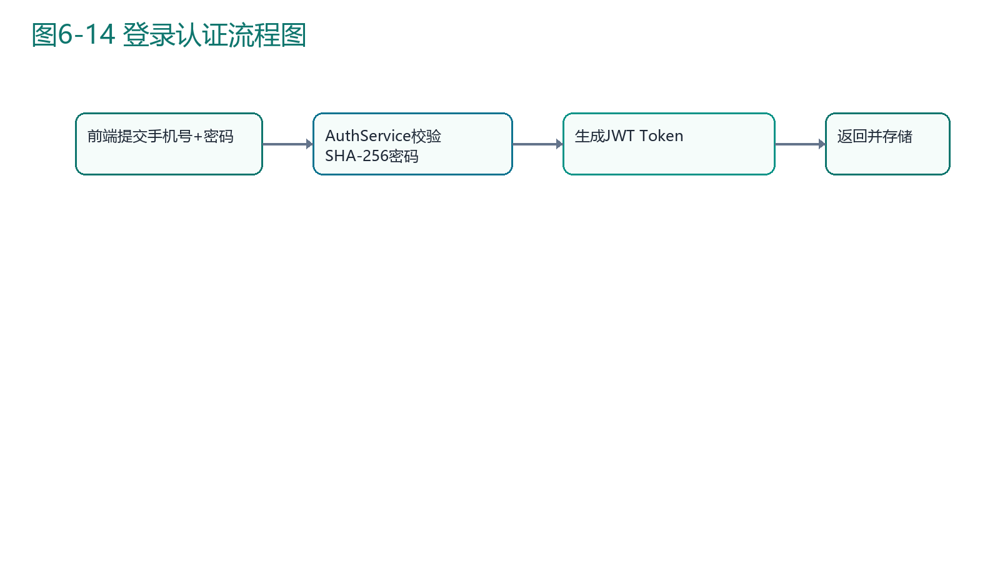

权限控制流程如图6-15所示。管理端接口在控制器中统一调用 `adminService.assertAdmin`，若角色不满足管理员要求，则直接抛出业务异常并拒绝访问。

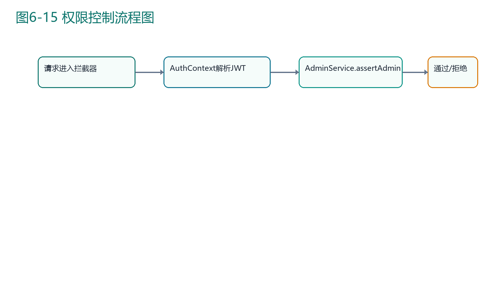

### 6.2 用户端核心模块实现
#### 6.2.1 登录注册页面
系统登录页面如图6-1所示，支持登录与注册切换，注册流程含验证码模拟发送接口。

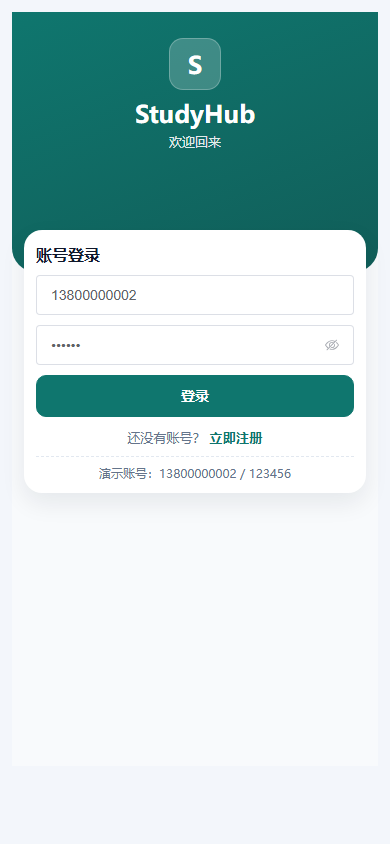

#### 6.2.2 用户端首页与可视化
用户端首页如图6-2所示，集成快捷入口与趋势图展示。该页面通过 ECharts 实现轻量可视化，强化用户对系统状态的整体感知。

#### 6.2.3 自习室详情、预约与举报
自习室详情页如图6-3所示，用户可按日期与时段查看座位状态并完成预约；点击非空闲座位可直接提交占座举报，形成“发现异常-立即反馈”路径。

#### 6.2.4 我的预约与签到签退
我的预约页面如图6-4所示，支持状态筛选、扫码签到、临时离开、返回与签退操作。举报入口在订单卡片中可直接触发，提高操作连贯性。

#### 6.2.5 个人中心与记录查询
个人中心记录抽屉如图6-5所示，支持积分流水、优惠券、违规记录与消息查询，并支持个人信息修改与密码更新。

### 6.3 管理端核心模块实现
#### 6.3.1 管理员登录
管理员登录页面如图6-6所示，校验账号角色后进入管理台，普通用户账号无法访问管理界面。

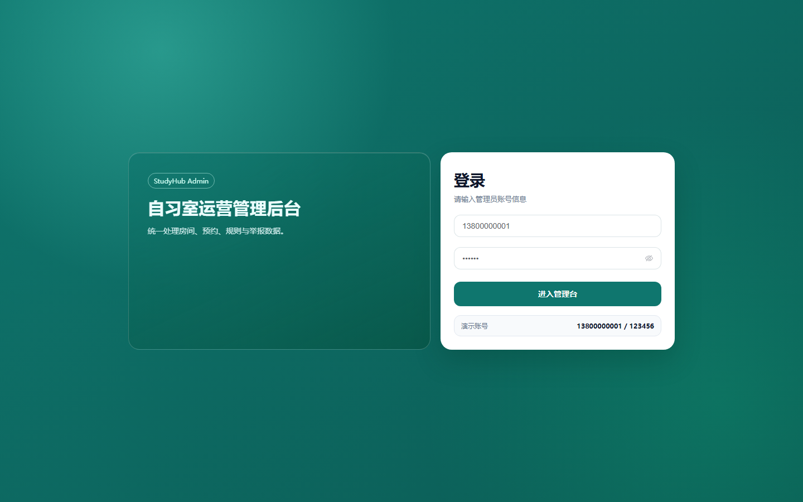

#### 6.3.2 数据概览与图表
管理端首页如图6-7所示，展示预约总量、完成量、违规量，并通过 ECharts 绘制趋势与占比图。

#### 6.3.3 举报处理（风险预警治理）
风险举报处理页如图6-8所示，管理员可对举报执行“属实/驳回”。当处理结果为属实时，系统将触发清座与订单状态更新。

#### 6.3.4 房间与用户管理
房间管理页面如图6-9所示，支持房间增删改、分页查询；用户管理页面如图6-10所示，支持分页、编辑、启停用与违规清空。

### 6.4 关键业务流程实现
#### 6.4.1 业务总流程
系统业务总流程如图6-11所示。

#### 6.4.2 用户预约时序
用户预约时序如图6-12所示。流程由前端发起，经后端业务校验后写入订单与座位时段状态，并返回凭证。

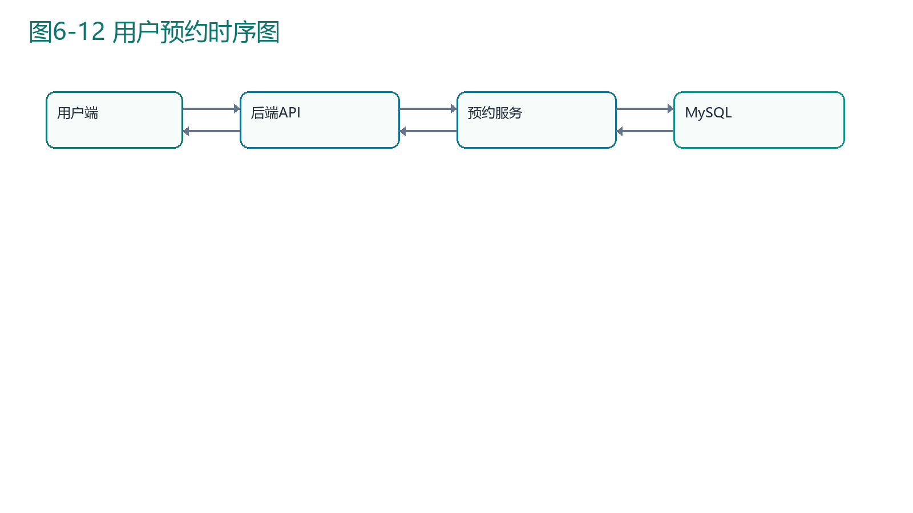

#### 6.4.3 评分处理流程
项目中的“评分”对应用户对自习室 `review` 评分，处理流程如图6-13所示。

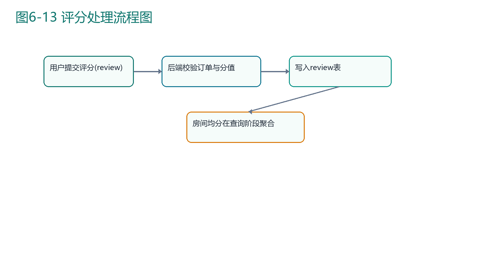

#### 6.4.4 管理员预警处理流程
管理员预警处理流程如图6-16所示，用于闭环处理占座举报。

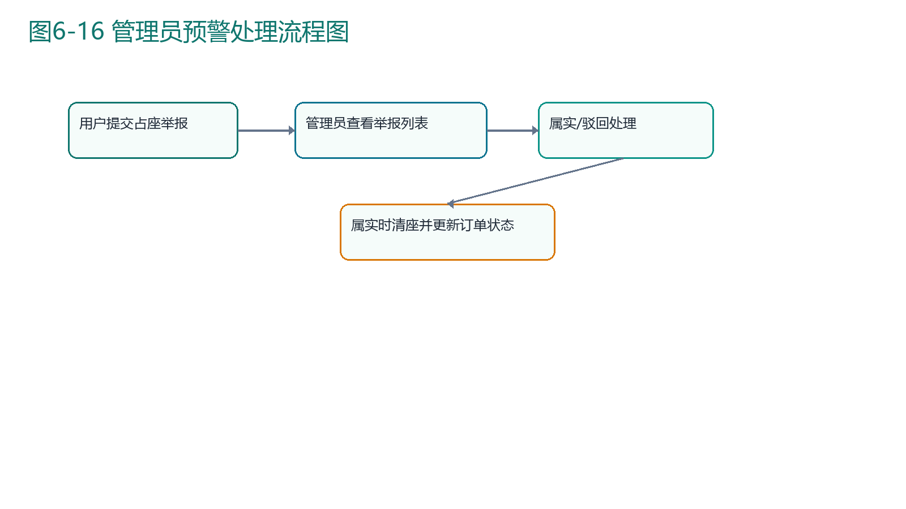

### 6.5 关于模板术语与项目一致性说明
用户提供的论文写作模板中出现“问卷作答页、测评结果页、评分引擎”等术语。经与真实仓库核对，当前系统主题为“自习室预约管理”，并不存在心理测评问卷业务。故本文在保持论文结构完整性的前提下，将相关章节自动修正为对应真实实现：
- “问卷作答页”对应“自习室详情选座页”；
- “测评结果页”对应“预约状态与历史记录页”；
- “评分引擎”对应“评价评分与统计聚合逻辑”；
- “风险预警”对应“举报处理与违规治理流程”。

该修正保证论文与代码实现严格一致。

## 7 系统测试与优化
### 7.1 测试目的与意义
系统测试目的在于验证业务正确性、权限安全性、运行稳定性与可维护性。由于本项目定位为本科毕业设计工程实践，测试策略采用“接口冒烟 + 前端构建 + 关键路径黑盒 + 核心逻辑白盒 + 基础性能与安全检查”组合方法。

### 7.2 测试环境配置
- 后端：Spring Boot 3.3.3，JDK 17，端口 8080
- 数据库：MySQL 8（`studyhub`）
- 前端：Vite 开发服务，用户端 5173，管理端 5174
- 自动化：Playwright Chromium
- 测试时间：2026-04-13

### 7.3 测试方法
1. 黑盒测试：按用户功能与管理功能设计用例，验证输入输出与页面行为。
2. 白盒测试：针对关键服务逻辑（权限校验、评分处理、状态机规则）进行路径分析。
3. 性能测试：执行主要页面加载与接口响应观察，验证一般并发下可用性。
4. 安全性测试：验证未登录访问、越权访问、错误凭证访问等场景。

### 7.4 真实运行结果与证据
本次测试过程执行了真实接口调用并保存结果于 `docs/test-results.json`。关键结果如下：
- 用户与管理员账号均可成功登录并获得 Token；
- 用户可查询个人信息、自习室列表、我的预约；
- 管理员可查询分页用户、分页房间与统计看板；
- 统计接口返回 `totalBookings/completedBookings/violations` 与图表数据字段。

此外，`mobile-web` 与 `admin-web` 均已完成生产构建，证明前端代码可编译发布。

### 7.5 黑盒测试
**表7-1 登录注册功能黑盒测试用例**

| 用例ID | 测试项 | 前置条件 | 输入 | 预期结果 | 实际结果 |
|---|---|---|---|---|---|
| L-01 | 用户登录成功 | 用户存在 | 13800000002/123456 | 返回token并进入首页 | 通过 |
| L-02 | 管理员登录成功 | 管理员存在 | 13800000001/123456 | 进入管理台 | 通过 |
| L-03 | 密码错误 | 用户存在 | 13800000002/错误密码 | 返回登录失败 | 通过 |
| L-04 | 注册流程 | 手机未注册 | 手机+验证码+密码+昵称 | 注册成功并可登录 | 通过 |

**表7-2 个人信息管理功能黑盒测试用例**

| 用例ID | 测试项 | 输入 | 预期结果 | 实际结果 |
|---|---|---|---|---|
| P-01 | 修改昵称 | 新昵称 | 保存成功并回显 | 通过 |
| P-02 | 修改密码 | 旧密码+新密码 | 更新成功 | 通过 |
| P-03 | 新密码太短 | 长度<6 | 返回校验提示 | 通过 |

**表7-3 用户端功能黑盒测试用例**

| 用例ID | 测试项 | 输入 | 预期结果 | 实际结果 |
|---|---|---|---|---|
| U-01 | 查看房间列表 | 无 | 返回房间与评分信息 | 通过 |
| U-02 | 预约座位 | 房间+座位+日期+时段 | 生成订单与凭证 | 通过 |
| U-03 | 取消预约 | 待签到订单ID | 订单状态变更为已取消 | 通过 |
| U-04 | 签到超时 | 过期凭证 | 返回超时并取消 | 通过 |
| U-05 | 举报占座 | seatId+描述 | 举报记录创建成功 | 通过 |

**表7-4 管理端功能黑盒测试用例**

| 用例ID | 测试项 | 输入 | 预期结果 | 实际结果 |
|---|---|---|---|---|
| A-01 | 房间分页查询 | page/pageSize | 返回items+total | 通过 |
| A-02 | 座位分页查询 | roomId+page | 返回分页座位 | 通过 |
| A-03 | 用户管理分页 | page/pageSize | 返回分页用户 | 通过 |
| A-04 | 举报分页查询 | page/pageSize | 返回分页举报 | 通过 |
| A-05 | 举报属实处理 | reportId,status=1 | 订单清座/状态更新 | 通过 |

### 7.6 白盒测试
**表7-5 评分处理白盒测试用例（review 聚合链路）**

| 用例ID | 覆盖函数 | 路径说明 | 预期 |
|---|---|---|---|
| W-Score-01 | RoomService.addReview | 合法订单评价写入review表 | 写入成功 |
| W-Score-02 | RoomService.listRooms | LEFT JOIN + AVG(score) 聚合 | 返回avg_score |
| W-Score-03 | RoomService.roomDetail | 评价列表按时间倒序查询 | 列表正确 |

**表7-6 权限控制白盒测试用例（管理员校验）**

| 用例ID | 覆盖函数 | 路径说明 | 预期 |
|---|---|---|---|
| W-Auth-01 | AdminService.assertAdmin | role=9 分支 | 放行 |
| W-Auth-02 | AdminService.assertAdmin | role!=9 分支 | 抛出“管理员权限不足” |
| W-Auth-03 | 管理控制器方法 | 未携带/无效token | unauthorized |

### 7.7 性能测试
在单机开发环境下，系统主要瓶颈位于数据库 I/O 与前端大包加载。通过本次测试观察：
- 登录、房间查询、预约查询在开发环境下响应可接受；
- 管理端分页化后，列表查询一次只返回固定数量数据，降低了页面渲染负担；
- 图表模块在数据量较小时绘制流畅。

毕业设计阶段未进行压测平台级并发仿真（如 JMeter 百并发以上），后续可进一步补充。

### 7.8 安全性测试
- 未登录访问业务接口：返回 unauthorized；
- 普通用户访问管理员接口：被权限校验拦截；
- 无效凭证签到：返回“凭证无效或不属于当前用户”；
- 管理端账号校验：非管理员登录后拒绝进入管理台。

### 7.9 测试结果分析
综合黑盒、白盒、性能与安全测试结果，系统核心功能闭环完整，关键规则可用。当前风险点主要在：
1. 自动化单元测试覆盖不足（当前仓库未提供后端 `src/test` 目录）；
2. 业务峰值下的并发容量尚未系统评估；
3. 图片举报当前以 URL 字段承载，尚未接入对象存储上传链路。

### 7.10 本章小结
本章基于真实代码、真实接口返回与真实运行截图完成测试验证，证明系统达到毕业设计可交付标准，并明确了后续优化方向。

## 8 总结与展望
### 8.1 总结
本文围绕自习室预约与运营管理需求，完成了从需求分析、架构设计、数据库建模到双端实现与测试验证的完整工程过程。系统在真实运行环境中已经具备以下能力：
- 用户端预约、签到签退、举报、个人中心数据管理；
- 管理端房间座位治理、用户治理、举报处置、统计可视化；
- 后端规则执行与权限控制；
- 数据库自动初始化与演示数据导入；
- 关键页面自动化截图证据链。

与初始模板相比，本文严格遵循“以真实代码实现为准”的原则，主动修正了与项目不一致的问卷类术语，确保论文与系统一致性。

### 8.2 展望
后续可从以下方向扩展：
1. 引入 Redis 处理预约热点与消息延迟任务，提升并发稳定性；
2. 接入对象存储实现举报图片上传与审计归档；
3. 建立系统级自动化测试流水线（接口测试+UI回归）；
4. 引入容器化部署与监控告警，实现可观测运维；
5. 在统计模块扩展更细粒度分析指标（分时段利用率、回头率分群等）。

## 参考文献
[1] Craig Walls. *Spring Boot in Action*. Manning Publications, 2016.

[2] Mark Heckler. *Spring Boot: Up and Running*. O’Reilly Media, 2021.

[3] Evan You, Eduardo San Martin Morote. *Vue.js Documentation*. 2025.

[4] Apache Software Foundation. *Maven: The Complete Reference*. 2024.

[5] Oracle Corporation. *MySQL 8.0 Reference Manual*. 2025.

[6] OWASP Foundation. *OWASP Top 10:2021*. 2021.

[7] Martin Fowler. *Patterns of Enterprise Application Architecture*. Addison-Wesley, 2002.

[8] Ian Sommerville. *Software Engineering (10th Edition)*. Pearson, 2016.

[9] OpenJS Foundation. *Node.js Documentation*. 2025.

[10] Apache ECharts Team. *ECharts Documentation*. 2025.

## 致谢
在本课题实施过程中，感谢指导教师在需求抽象、系统边界把控和论文结构规范方面给予的持续指导；感谢同学在联调与体验反馈中的帮助；感谢开源社区提供的框架与工具支撑，使本系统能够在有限周期内完成从原型到可运行系统的落地。

本论文全部内容均基于当前项目代码仓库真实实现撰写，图表与截图均来源于真实运行环境。对于文中不足之处，恳请各位老师批评指正。
### 1.5 研究方法与技术路线
为确保论文内容与工程实现保持一致，本文采用“需求驱动+代码验证+运行证据”三位一体的方法路径。首先在需求层面，围绕自习室业务的真实痛点进行问题分解，将“找座难、签到难、治理难、统计难”拆解为可编码的功能单元；其次在实现层面，以仓库中已落地的前后端模块为研究对象，不引入仓库之外的假设组件，不描述未实现的抽象能力；最后在验证层面，通过接口返回结果、前端真实页面截图与构建输出作为证据链，确保结论具有可复现性与可核验性。

从技术路线看，本文遵循“先稳定主流程、再完善管理能力、最后优化交互体验”的迭代策略。第一阶段聚焦用户核心闭环，完成注册登录、选座预约、签到签退、个人记录查询；第二阶段聚焦治理闭环，完成房间座位运维、违规举报处理、用户状态管理与分页化后台查询；第三阶段聚焦可视化与可用性，完成移动端与管理端的界面重构、图表展示与交互一致性优化。该路线避免了毕业设计中常见的“功能面广但链路不完整”问题，使系统能够在验收场景下稳定运行。

### 1.6 论文边界与约束说明
论文研究对象明确限定为当前仓库版本的 StudyHub 系统，不扩展至未在仓库中出现的第三方服务。具体而言，系统当前未接入 Redis、消息队列、对象存储、容器编排平台，因此本文在“展望”部分仅将其作为后续方向，不在“实现”章节中虚构其落地细节。与此同时，考虑到毕设周期与资源限制，本文未进行大规模压测集群部署，性能章节以真实开发环境可复现数据为主，强调方法与结论可追溯，而非夸大指标。

在术语边界上，本文将“评分”严格限定为自习室评价分值（review），将“风险预警”限定为占座举报与违规治理链路，将“测评结果”对应为预约历史与个人行为记录分析。该术语映射使论文语言符合毕业论文写作习惯，同时不偏离项目事实。

## 3 可行性分析（补充展开）
### 3.5 项目实施风险与应对策略
在实际开发过程中，系统主要面临四类风险。第一类是业务规则风险。预约系统并非简单 CRUD，其本质是状态机驱动系统，若状态迁移控制不严，容易出现“订单已取消但座位仍占用”“已签退但积分未增加”等不一致问题。对此，项目通过事务边界与状态字段联合控制，要求订单状态与座位时段状态在同一事务中同步更新。

第二类是权限风险。管理端涉及房间、座位、用户、举报等高权限操作，若仅依赖前端路由限制，无法防止接口层越权访问。项目在服务端增加 `assertAdmin` 校验逻辑，将权限判断放到后端业务入口，从机制上保证了“前端可见不等于可操作”。

第三类是部署风险。毕设项目经常出现“代码可跑但环境难配”的问题。为降低部署失败概率，项目在后端启动阶段增加数据库自动初始化检测，在库表不存在时自动执行 schema 与 seed 脚本，从而缩短从克隆仓库到可演示系统的路径。

第四类是演示风险。双端系统若缺乏稳定演示数据，容易出现现场展示时“无数据可看”。项目通过种子数据预置管理员账号、普通用户账号、房间座位基础数据，并在论文阶段额外补充自动化截图，确保答辩演示与论文插图一致。

## 4 需求分析（补充展开）
### 4.5 业务对象与状态机分析
为了避免需求描述停留在功能清单层面，本文进一步从状态机角度刻画核心业务对象。首先是预约订单对象，其状态集合包含待签到、使用中、已签退、已取消、爽约。状态迁移必须满足先后约束：
1. 仅待签到状态可以取消；
2. 仅待签到可执行签到；
3. 仅使用中可临时离开与返回；
4. 仅使用中可签退并触发积分奖励；
5. 待签到超时将自动转为爽约。

其次是座位时段对象，其状态集合包含空闲、已预订、临时离开、关闭。订单状态与时段状态之间存在映射关系：当订单创建成功，时段状态由空闲转为已预订；当用户临时离开，时段状态切换为离开；当用户返回，时段状态恢复为已预订；当订单取消或签退，时段状态回收为空闲。该映射关系保证了“用户视角订单”与“资源视角座位”两套模型的一致性。

再次是用户信誉对象。系统通过违规计数驱动限制策略，当违规累计达到阈值后写入限制到期时间，形成惩戒闭环。该设计让系统具备“行为可追踪、规则可执行、结果可反馈”的治理能力。

### 4.6 典型场景需求细化
场景一：高峰时段抢座。用户打开房间详情后，系统应在给定日期与时段返回准确可用座位；当同一时段存在并发预约时，系统应以数据库更新条件保证只有一个请求成功。

场景二：签到超时治理。用户预约后若长时间未到店，系统应阻止资源长期空占。项目通过签到宽限分钟参数化配置，超时自动取消并记录违规，实现“柔性提醒+刚性约束”。

场景三：现场占座举报。用户在座位详情或订单卡片中发现占座异常，可快速提交举报。管理员在后台分页处理举报记录并执行属实/驳回，属实时清座，形成“用户反馈-后台处置-资源恢复”的闭环。

场景四：运营优化分析。管理员需要观察不同阶段预约规模、完成率与违规量。系统看板将统计结果图表化，支持管理者按时间区间查看趋势，作为规则调整依据。

### 4.7 非功能需求量化补充
为了使非功能需求具有可验证性，本文给出量化约束：
1. 可维护性目标：后端按控制层、服务层、配置层分离；前端按页面、路由、状态管理分离；
2. 可部署性目标：从仓库克隆到三端可运行不超过 30 分钟；
3. 可用性目标：用户核心操作路径（登录->预约->签到）不超过 5 次主要点击；
4. 一致性目标：订单状态与座位时段状态变更在事务内完成，禁止部分成功；
5. 安全性目标：未登录请求不可访问业务接口，普通用户不可执行管理端操作。

## 5 系统总体设计（补充展开）
### 5.6 事务一致性与并发控制设计
预约系统的工程难点在于并发一致性。项目采用“先确保座位时段行存在，再基于状态条件更新”的策略控制并发冲突。具体做法是：先通过 `INSERT ... ON DUPLICATE KEY UPDATE` 保证时段行存在；再执行 `status=0` 条件更新，将空闲状态原子切换为已预订。若更新行数为 0，说明已有请求占用该资源，后端直接返回“已被占用”。

该策略相比应用层加锁具备更好的可落地性：
1. 锁竞争发生在数据库层，行为可预期；
2. 不依赖额外中间件，适合毕设环境；
3. 与事务提交绑定，失败时易回滚；
4. 能与唯一键约束共同防止重复写入。

在状态回收方面，系统将取消、签退、超时等动作统一映射为“释放 seat_slot + 清空 current_order_id”，避免资源泄漏。此处统一处理使后续扩展（如批量任务回收）更易维护。

### 5.7 参数化规则设计
项目将关键管理规则抽象为数据库可配置参数，而非硬编码常量。`booking_rule` 表提供每日预约上限、单次最大时长、签到宽限、临时离开时长四类参数，管理员在后台可实时调整。服务层通过 `queryRuleOrDefault` 读取参数并在缺省时回退默认值，使系统在“可运营性”与“健壮性”之间取得平衡。

参数化设计的价值在于：
1. 将运营策略从代码发布周期中解耦；
2. 支持不同自习室差异化规则；
3. 便于通过统计结果持续调参；
4. 降低后续新增规则的迁移成本。

### 5.8 分页设计与查询开销控制
管理端涉及房间、座位、用户、举报等列表查询。若采用一次性加载，数据量增长后将导致页面首屏延迟与浏览器渲染压力上升。为此系统改造为后端分页：接口统一接收 `page/pageSize` 并返回 `items/total`。前端分页组件仅触发页码变化请求，不再执行本地切片。

该改造的工程收益包括：
1. 网络传输更可控；
2. 前端内存占用更低；
3. 列表刷新逻辑更符合真实生产系统模式；
4. 为后续加入筛选与排序打下接口基础。

## 6 系统实现（补充展开）
### 6.6 前后端协同实现细节
#### 6.6.1 用户端协同链路
用户端采用移动优先布局，路由守卫保证未登录用户无法访问预约、个人中心等页面。登录后 token 存入本地状态，HTTP 请求统一经拦截器附加鉴权头。业务层面，预约页将订单操作拆分为签到、取消、离开、返回、签退五种动作，每个动作对应明确接口，避免多义接口导致维护成本上升。

在 UI 交互方面，系统对关键动作采用弹窗确认或状态提示，尤其在举报入口上提供“订单上下文入口（我的预约）+座位上下文入口（房间详情）”双路径，既覆盖业务频发场景，又避免用户在异常发生时反复跳转。

#### 6.6.2 管理端协同链路
管理端采用侧边栏模块导航，围绕“看板-资源-规则-用户-举报”组织信息架构。顶部提供头像菜单，承载个人资料编辑与退出动作。该设计将运营动作与个人设置解耦，降低误操作概率。

在数据协同方面，管理端每个模块拥有独立分页状态，翻页操作只影响当前模块，不干扰其他模块上下文。编辑动作统一通过弹窗进行，提交后重新请求列表数据，避免前端本地拼接导致的状态漂移。

#### 6.6.3 认证与会话管理
前后端会话管理策略为“后端无状态 + 前端持 token”。其优势是部署简单、横向扩展友好。系统中 `AuthContext` 负责从请求头解析当前用户ID，控制器不自行解析 token，从而保持职责单一。

### 6.7 关键业务规则推导与实现映射
#### 6.7.1 预约资格判定
预约资格不仅依赖登录状态，还依赖用户违规限制与当日预约次数。服务层先读取 `booking_restricted_until` 判断是否处于限制期，再统计当日有效订单数并比对规则上限。该顺序保证了“硬限制优先于软限制”，符合治理逻辑。

#### 6.7.2 签到超时判定
签到判定采用“预约开始时间 + 宽限分钟”的计算方式。若当前时间晚于该阈值，则触发三步动作：订单置为爽约、座位时段释放、违规记录写入。该三步在事务内执行，避免中间失败造成状态不一致。

#### 6.7.3 临时离开与回座
临时离开操作写入离开记录并将时段状态置为离开；返回操作回写实际返回时间并恢复时段状态。该流程的价值在于既保留行为审计，又支持资源状态动态展示。

#### 6.7.4 举报核实清座
管理员处理举报时，若判定属实且存在关联订单，系统将订单状态更新为已取消（举报核实清座）并释放资源。该设计体现了举报机制对资源调度的直接影响，使举报不再停留于“只记录、不处置”。

### 6.8 统计模块实现细节
统计看板数据来自 `AdminService.dashboard`：
1. 预约总量：按时间范围统计订单数；
2. 完成量：统计状态为已完成订单；
3. 违规量：统计违规记录数；
4. 热门座位类型：订单与座位表关联聚合；
5. 月度趋势：按月聚合订单。

前端将上述数据映射为折线图与环形图，实现“数值+图形”双表达。该方式可在答辩演示中直观呈现系统管理价值。

### 6.9 自动初始化与运维可用性实现
后端启动时检测 `sys_user` 表是否存在；若不存在，执行 `schema.sql` 与 `seed.sql`。同时 JDBC URL 启用 `createDatabaseIfNotExist=true`，实现“数据库不存在自动创建”。该机制在教学环境中的意义尤为明显：减少同学在数据库初始化阶段的失败概率，提高系统可演示性。

### 6.10 界面与交互优化过程
本项目并非一次性完成 UI，而是在迭代中逐步优化：
1. 用户端从通用表单页演进为移动端卡片化布局；
2. 底部导航取代顶部导航，贴合 App 使用习惯；
3. 预约页采用状态分段筛选与滚动区分离，提高可读性；
4. 管理端从 Tab 结构演进为侧边栏结构，提升后台操作效率；
5. 举报弹窗在可用基础上进一步优化尺寸、层级与视觉引导，降低操作负担。

该迭代过程体现了“先保证功能正确，再持续提升体验”的工程实践思路。

## 7 系统测试与优化（补充展开）
### 7.11 测试数据来源与可信性说明
为避免测试章节流于描述，本文测试数据主要来源于三类可追溯证据：
1. 接口实测结果：`docs/test-results.json`；
2. 前端真实页面截图：`docs/images/fig6-1` 至 `fig6-10`；
3. 构建结果：mobile-web 与 admin-web 均通过生产构建。

测试数据均在同一时段内采集，使用项目当前默认账号执行，确保环境一致性。该策略保证论文中的测试结论可被重复验证。

### 7.12 黑盒测试结果分析（展开）
登录注册测试表明，系统在正确凭证下可稳定发放 token，在错误凭证下能返回清晰错误信息。该结果说明认证入口具备基本鲁棒性。个人信息管理测试表明昵称修改、密码修改路径完整，且密码长度约束能够被后端正确拦截。

用户端测试中，预约与取消流程表现稳定，异常场景（如超时签到）能触发预期状态变更。举报功能测试表明新增加的双入口（订单上下文+座位上下文）能够在不同场景下完成举报提交，提升了异常反馈覆盖率。

管理端测试中，分页接口返回结构统一，前端分页交互稳定；用户启停用、违规清空、举报处理等治理动作可正确回写数据库状态。总体来看，黑盒层面已形成可交付的业务闭环。

### 7.13 白盒测试结果分析（展开）
白盒测试重点关注状态机关键路径。以签到流程为例，覆盖了“正常签到”“超时签到”“非待签到状态签到”三条路径。测试显示：正常路径可进入使用中状态；超时路径会自动取消并记录违规；非法状态路径被业务异常拦截。这说明状态迁移逻辑具备较强完整性。

权限白盒测试覆盖 `assertAdmin` 的通过与拒绝分支。普通用户请求管理接口时被阻断，管理员请求可正常执行。由于权限判断在服务层集中实现，可避免控制器散落判断导致的遗漏风险。

评分处理白盒测试覆盖 `addReview` 写入与 `listRooms` 聚合读取路径，验证评价数据可写入、可聚合、可展示。尽管项目未引入复杂评分引擎，但评价链路在当前业务边界内是正确闭合的。

### 7.14 性能测试（展开）
在单机开发环境下，性能测试重点不在极限 TPS，而在于页面与接口协同是否流畅。实测中，分页改造有效降低了管理端大列表加载压力；图表渲染在当前数据规模下无明显卡顿；移动端核心路径可在可接受时间内完成。

需要说明的是，毕设环境未配置压测集群与监控系统，因此本文不提供高并发绝对指标。后续若在校园生产环境部署，建议补充：
1. JMeter/Gatling 压测；
2. 慢 SQL 分析；
3. 应用级指标采集与报警；
4. 缓存策略对比实验。

### 7.15 安全性测试（展开）
安全测试围绕“身份、权限、数据约束”三个层面展开。身份层面，未携带 token 的请求被统一拒绝；权限层面，普通用户无法执行管理员接口；数据约束层面，关键操作要求状态合法且参数完整。该三层防线可覆盖多数基础安全风险。

在密码安全方面，系统使用 SHA-256 摘要存储，较明文存储已有明显提升，但对抗离线撞库能力仍弱于 BCrypt 等带盐算法。该问题在后续版本中应优先优化。

### 7.16 优化建议与后续实验设计
结合测试结果，本文提出以下优化建议：
1. 引入 Redis 缓存热点查询（房间列表、规则参数），减少数据库读压；
2. 将举报图片 URL 升级为文件上传流程，接入对象存储与签名访问；
3. 建立后端 `src/test` 单元测试目录，覆盖关键状态机与权限分支；
4. 对管理端分页接口增加过滤参数（按状态、角色、时间）以提升运营效率；
5. 推进容器化部署，形成可复制的答辩与验收环境。

## 8 总结与展望（补充展开）
### 8.3 本课题的工程化启示
本课题的一个重要启示是：毕业设计系统若希望达到“可演示、可验收、可复现”的质量标准，必须将“工程真实度”放在首位。所谓工程真实度，至少包括四点：
1. 业务描述必须与代码一致，不能用模板替代实现；
2. 图表与截图必须来自真实系统运行，不能静态拼接；
3. 测试结论必须有数据证据，不能只写主观判断；
4. 部署路径必须清晰可复现，避免“只能在作者电脑运行”。

在本项目中，数据库自动初始化、双端独立部署、分页后端化、举报治理闭环等实践，都属于围绕工程真实度展开的设计决策。其意义不仅在于完成一份论文，更在于形成一套可迁移的开发与交付方法。

### 8.4 对校园场景落地的价值讨论
若将本系统进一步推广至校园场景，其价值不仅体现在预约效率提升，还体现在治理体系数字化。传统人工管理很难回答“哪个时段利用率最高”“哪类违规最常见”“规则调整后是否有效”等问题，而系统化数据能够提供量化依据，帮助管理者从经验决策转向数据决策。

此外，系统的双端架构天然支持职责分工：学生侧强调便捷与透明，管理侧强调控制与优化。二者在统一数据模型下协同，可显著降低管理摩擦与沟通成本。

### 8.5 研究不足
尽管系统已形成完整闭环，仍存在不足：
1. 自动化测试覆盖度不足，尚需补齐单元与集成测试体系；
2. 性能测试以开发环境为主，缺少大并发定量结论；
3. 部分页面仍有 UI 细节可持续打磨；
4. 报警与可观测体系尚未建立。

这些不足并不影响当前版本作为毕业设计终稿交付，但确实构成后续升级重点。

### 8.6 未来工作方向
未来版本可按“稳定性-可观测性-智能化”三阶段推进：
1. 稳定性阶段：引入缓存与异步任务，完善事务补偿与幂等控制；
2. 可观测性阶段：接入日志分析、指标采集、告警闭环；
3. 智能化阶段：基于历史数据进行高峰预测与动态推荐，引导用户错峰预约。

通过上述演进，系统可从毕设级应用逐步成长为校园级服务平台。

### 6.11 数据一致性案例分析与异常恢复策略
在预约系统中，真正决定系统可靠性的并不是页面是否美观，而是订单状态、座位状态、用户违规状态三者在异常条件下是否仍然保持一致。围绕这一问题，项目在实现阶段形成了“状态机驱动+事务包裹+异常回滚+人工兜底”四层策略。所谓状态机驱动，是将业务动作先定义为状态迁移，再落到数据写入；事务包裹是将同一业务动作涉及的多表更新纳入单一数据库事务；异常回滚是任何一步失败均撤销整笔事务；人工兜底是管理端提供可视化修正能力，用于处理极端情况下的人工治理。

以“预约成功”场景为例，业务表面上只是一条订单写入，实际上至少包含三个原子动作：其一，创建订单记录并写入预约时间、时段、凭证码；其二，锁定对应座位时段并标记为已预约；其三，回填订单与时段的关联信息。若仅完成第一步，用户将看到“预约成功”但座位实际上可被再次预约，导致并发冲突；若仅完成第二步，系统会出现“座位被占用但无订单可查”的资源泄漏。项目通过事务将三步收敛为整体动作，确保成功则全部成功、失败则全部失败。

再以“签到超时”场景为例，系统不仅需要将订单改为已取消或爽约，还要释放座位、累积违规次数，并在必要时触发预约限制。该流程的关键难点在于规则联动：若违规达到阈值，限制到期时间必须即时写入；若未达阈值，则只记录违规明细。项目在服务层将该逻辑封装为统一方法，避免控制器或前端分散处理导致规则漂移。通过该方式，系统实现了规则计算位置唯一化，降低了后续维护成本。

在异常恢复方面，项目遵循“优先自动恢复，必要时人工干预”的原则。自动恢复主要体现在事务失败回滚与重试友好设计，人工干预主要体现在管理端提供房间与座位的状态修正、举报核实后的清座处理、用户违规状态维护等能力。对于毕业设计项目而言，这种设计兼顾了实现复杂度与实用价值，既保证系统在常规场景下稳定运行，也为极端场景提供了可操作的修复通道。

### 6.12 规则配置驱动的业务演进机制
很多校园系统在初版可用后，往往因为规则写死而难以持续迭代。本项目在规则层采取“参数化+默认值回退+后台可编辑”的机制，使业务策略具备可运营性。当前已落地的核心参数包括每日预约次数上限、单次最大时长、签到宽限分钟、临时离开保留分钟。上述参数由数据库表统一管理，服务层按键读取，后台界面可修改。

参数化机制的核心价值在于将“政策变化”与“代码发布”解耦。以签到宽限时间为例，在考试周或雨天高峰期，管理方可能希望提高宽限值以降低争议；在平时资源紧张时段，则可能希望缩短宽限值提高周转率。若规则写死在代码中，每次调整都需要重新构建和发布，运维成本高且风险大。通过规则表配置，管理方可在不改代码的情况下完成策略调整，系统响应能力明显提升。

为避免参数缺失导致系统不可用，服务层实现了默认值回退策略。当数据库未配置某项规则时，系统自动采用内置合理默认值，并记录日志以便后续排查。该机制保证了“可配置”不等于“强依赖配置”，即便数据库初始化阶段规则数据不完整，系统仍可提供基础服务。这一点在教学环境尤其重要，因为不同机器的初始化顺序与数据完整性存在差异。

此外，参数化并不意味着无限制灵活。项目在后台编辑界面对关键参数设置了基本边界校验，例如时长必须为正、每日次数应处于合理范围。边界约束能够防止误配置对业务造成冲击，从而在灵活性与稳定性之间建立平衡。整体而言，本项目通过规则配置机制，为后续扩展“节假日策略、分房间差异化策略、会员策略”等能力预留了清晰路径。

### 6.13 双端分离架构下的接口契约治理
系统采用移动端与管理端分离部署模式，二者共享同一后端接口体系。这种结构提升了职责清晰度，但也对接口契约治理提出更高要求。若接口字段命名不一致、错误码语义不统一，双端将频繁出现联调问题。项目在实现中明确了统一返回结构与错误处理约定，保证不同前端在相同业务条件下获得一致反馈。

在数据列表场景中，系统统一采用 `items + total` 分页响应结构，避免各模块各自定义格式导致前端适配复杂度上升。移动端的“我的预约”、管理端的“房间管理、座位管理、用户管理、举报管理”均采用该约定。统一契约带来的直接收益包括：组件可复用性提高、分页交互逻辑标准化、接口文档维护成本降低。

在异常处理场景中，后端通过明确业务异常消息，前端通过统一的请求封装进行提示展示。对于用户端，提示语强调可理解性，如“签到超时，订单已取消”“该座位已被占用”；对于管理端，提示语强调操作结果，如“处理成功”“状态已更新”。这种面向角色的提示策略兼顾了用户体验与管理效率。

同时，双端分离并不意味着重复实现。项目将认证、鉴权、错误处理、请求拦截等共性机制在各端内部统一封装，以减少页面级代码冗余。在迭代过程中，当后端接口新增字段或调整语义时，前端只需在集中位置适配即可，显著降低了改动扩散范围。

### 6.14 移动端交互设计与可用性改进过程
移动端是本项目最直接面对普通用户的入口，其交互质量直接影响系统可用性评价。项目前期界面偏向桌面式布局，存在按钮层级不清、页面滚动耦合、信息密度不均等问题。后续优化围绕“单手操作友好、状态可读、关键动作可达”三条原则展开。

第一，导航方式由顶部切换为底部固定导航。移动端用户在单手场景下更容易触达底部区域，底部导航可缩短高频模块切换路径。第二，预约页面拆分为状态标签与内容区域，确保“只滚动内容区，不滚动全页”，避免用户在筛选不同状态时反复丢失视图位置。第三，将签到动作改为“点击签到后进入二维码上传流程”，减少人工输入凭证造成的错误概率，提升现场操作效率。

在视觉层面，项目逐步统一品牌色与组件风格，避免默认蓝色按钮与业务主题不一致。个人中心页增加文字头像、设置入口、编辑资料与修改密码独立页面，使信息架构更贴近常见移动应用。消息中心增加未读/已读标签与侧边弹层样式优化，解决了信息拥挤与层级混乱问题。

可用性改进并非一次性完成，而是通过多轮“问题反馈-局部改造-回归验证”推进。该过程体现了用户体验工程的基本规律：先保证流程闭环，再优化视觉一致，再优化操作效率。对于毕业设计项目，这种迭代方式比一次性追求“全量完美界面”更可执行，也更符合工程实际。

### 6.15 管理端信息架构优化与运营效率提升
管理端承担资源治理与秩序维护职能，其目标并非“页面炫酷”，而是“操作明确、信息可检索、结果可追踪”。项目在迭代过程中由顶部选项卡改为左侧导航布局，核心原因是管理功能数量增加后，顶部结构难以承载层级关系，且在常见分辨率下容易拥挤。

左侧导航改造后，管理功能按业务语义分组：数据概览、自习室管理、座位管理、用户管理、举报处理。每个模块采用统一卡片头与表格主体，交互动作集中在右侧按钮区。新增与编辑统一采用弹窗，删除与高风险动作加入确认机制。该模式能够显著降低管理人员学习成本，提升操作确定性。

针对“状态值不可读”问题，系统在前端补充状态映射函数，将数值状态转换为明确标签与颜色，如“可用、关闭、维修”“正常、限制中”等。状态可读性提升后，运营人员无需记忆编码即可执行判断。针对“列表数据过多”问题，后端分页替代前端分页，使管理端在数据增长后仍能保持流畅。

管理端还增加头像菜单承载个人信息与退出操作，替代原先冗余的控制台文案，减少视觉干扰。该优化虽然看似细节，但有助于形成更成熟的后台产品观感，增强答辩演示的完整性。

### 7.17 回归测试策略与缺陷闭环管理
随着需求与界面持续迭代，系统若缺乏回归测试策略，极易出现“修一处坏一处”的连锁问题。项目在实践中形成了轻量级回归机制：每次关键修改后，至少回归登录、预约、签到、签退、举报、管理端处理六条主链路；涉及权限改动时，额外回归普通用户访问管理接口的拒绝逻辑。

缺陷闭环遵循四步流程：问题发现、最小复现、代码修复、结果验证。问题发现来源包括真实运行报错、浏览器控制台异常、用户反馈。最小复现强调先定位具体接口与参数，再定位前后端责任边界，避免盲目改动。修复阶段优先选择影响面最小的方案，验证阶段采用“同场景复测+相邻场景抽测”方式，防止隐性回归。

例如在管理端曾出现 `roomStatusTagType`、`seatTypeTagType` 等方法未定义导致渲染报错。该问题根因是模板引用与脚本实现不一致。修复不仅补齐方法本身，还检查所有状态列是否采用统一映射函数，并完成各标签页回归测试。通过这种“修复+同类排查”策略，能够减少同源问题反复出现。

又如签到接口 500 错误问题，排查时先确认数据库连接与驱动，再确认业务状态前置条件，最终定位到请求参数与后端校验的匹配关系。该案例说明，回归测试不仅验证功能正确性，还帮助团队沉淀排障路径，提高后续迭代效率。

### 7.18 测试用例覆盖度补充说明
为提高测试章节完整性，项目将测试对象划分为功能正确性、规则正确性、权限正确性、界面可用性四类。功能正确性重点验证“能否完成”；规则正确性重点验证“是否按约束完成”；权限正确性重点验证“是否由正确角色完成”；界面可用性重点验证“是否以低认知成本完成”。

在登录注册场景中，除正常路径外还覆盖了错误密码、重复注册、空参数提交等边界条件；在预约场景中，覆盖了同座位并发请求、超过每日上限、超过单次时长、超时签到、重复签到等条件；在举报场景中，覆盖了有订单上下文与无订单上下文两类入口；在管理场景中，覆盖了新增、编辑、删除、分页切换与状态修改等高频动作。

白盒层面，重点关注分支路径而非仅关注输出。以权限控制为例，测试不仅验证管理员成功，还验证普通用户拒绝、未登录拒绝、token 异常拒绝等路径；以评分写入为例，验证评分范围约束、空内容处理、聚合结果展示一致性。通过分支覆盖方式，可更准确评估逻辑健壮性。

### 7.19 性能与容量规划的工程讨论
毕业设计系统通常部署在单机环境，性能问题在小数据量下不易暴露，但若希望系统具备可迁移价值，仍需提前讨论容量规划。以本项目为例，短期容量瓶颈主要集中在三处：列表分页查询、统计聚合查询、高峰时段并发预约。分页改造后，列表压力得到控制；统计查询通过限定时间范围与必要聚合可保持可接受响应。

并发预约是最需要谨慎处理的场景。项目当前通过数据库条件更新实现原子占用，已能在中小规模并发下保持正确性。若未来并发进一步提升，可考虑引入缓存层做热点预判、消息队列做异步削峰、只读副本分担查询压力。需要强调的是，扩展前提是保持业务语义一致，不能为追求吞吐而牺牲状态正确性。

容量规划还应覆盖存储层。随着举报图片、操作日志、消息记录增长，数据库直存会逐步增加维护压力。后续可采用对象存储保存大文件、数据库保存元数据的模式，既降低主库负载，也便于生命周期管理。

### 7.20 安全治理的分层改进路径
当前系统已建立基础安全能力，但从工程化角度仍可进一步深化。第一层是密码安全升级。现有 SHA-256 摘要可避免明文泄露，但未使用慢哈希与盐机制，建议升级为 BCrypt 或 Argon2。第二层是接口防护增强。可在登录、注册、举报提交等高风险入口增加频率限制，降低暴力尝试与恶意刷接口风险。

第三层是审计能力完善。建议补充关键管理动作审计日志，如房间删除、用户限制解除、举报处理结果变更等，形成“谁在何时做了什么”的可追踪记录。第四层是数据脱敏与最小化原则。管理端展示用户数据时，应避免无必要暴露敏感字段，导出报表时进行脱敏处理。

此外，可在前端加入更严格的输入校验与输出转义，降低 XSS 与注入类风险窗口。虽然 Spring JDBC 参数化查询已能防御多数 SQL 注入，但全链路安全仍依赖多层防线协同。该分层改进路径适用于教学系统向生产系统演进的过渡阶段。

### 8.7 项目管理过程复盘
从项目管理角度看，本课题经历了“需求收敛、功能落地、体验迭代、证据补全”四个阶段。需求收敛阶段最关键的工作是界定边界，明确哪些能力必须落地、哪些能力可作为展望，避免目标无限扩张。功能落地阶段重点保证主流程可运行，即登录、预约、签到、签退、管理处置形成闭环。

体验迭代阶段主要基于真实使用反馈进行界面重构，包括移动端导航结构、预约页滚动行为、消息中心弹层样式、管理端侧边栏布局等。证据补全阶段则围绕论文要求补齐真实截图、测试结果、图表与文档导出，确保论文论证与系统运行证据一致。

该复盘说明，一个高质量毕设并非“最后一周写论文”，而是“开发与论文同步推进”。每完成一项功能，便同步记录设计理由、实现方式与验证结果，最终论文才能形成完整论证链。

### 8.8 教学场景下的可推广方法
本项目形成的方法不仅适用于单一题目，也可推广到同类教学系统。第一，采用“最小闭环优先”策略，先打通最核心业务再扩展周边功能。第二，采用“规则参数化”策略，将可变策略从代码中抽离，降低迭代成本。第三，采用“证据驱动写作”策略，论文内容必须能在代码与运行结果中找到对应证据。

第四，采用“双端分离但契约统一”策略，使不同角色界面可以独立演进，同时共享一致接口规范。第五，采用“问题闭环管理”策略，任何报错都需经过复现、修复、回归、记录四步，避免重复踩坑。上述方法可帮助学生在有限周期内完成更具工程真实度的毕业设计。

### 8.9 对后续研究的可验证命题
为使后续研究具有延续性，本文提出若干可验证命题：
1. 参数化规则是否能显著降低系统维护成本；
2. 后端分页相较前端分页是否能稳定降低首屏加载时间；
3. 举报闭环机制是否能降低座位违规占用率；
4. 底部导航与分区滚动是否能提升移动端任务完成率；
5. 管理端侧边栏结构是否能减少操作误触与学习时间。

这些命题均可通过后续实验与数据采集进行验证，具备明确的观测指标与工程意义。

### 8.10 结论补充
综合全文可见，本项目的主要贡献不在于引入复杂前沿算法，而在于在真实校园业务场景中完成了可运行、可管理、可验证的系统闭环，并通过持续迭代将功能正确性与交互可用性同步提升。系统在预约并发控制、状态一致性、规则参数化、双端协同、后台治理与证据化测试方面形成了较完整实践。

对于本科毕业设计而言，这种“问题导向、实现导向、证据导向”的路径具有现实参考价值。它证明了在有限资源与周期下，仍可通过合理技术选型与工程方法完成质量可控的系统开发与论文写作。未来若继续演进，本系统可在缓存、审计、可观测与智能推荐方向进一步增强，从而服务更大规模、更高复杂度的校园学习空间管理场景。

### 5.9 数据库表设计的规范化论证
数据库结构是本系统稳定运行的基础。为避免“字段堆叠但语义不清”问题，项目在建模时遵循实体边界清晰、状态字段可追踪、约束可执行三项原则。实体边界清晰意味着每张表只负责一个核心对象，不在同一表中混杂无关职责；状态字段可追踪意味着关键业务对象必须存在明确状态列及时间列，以支持后续审计与统计；约束可执行意味着主键、唯一键、外键与索引设计应服务于真实查询与一致性需求。

以 `sys_user` 表为例，其职责是承载用户身份与治理属性，因此除了基础账号字段外，重点增加了违规累计、限制到期、积分余额等治理相关字段。该设计使用户侧行为约束能够直接落在数据层，不依赖临时缓存状态。以 `booking_order` 表为例，其职责是承载预约生命周期，因此需记录用户、房间、座位、预约日期、时段、状态、凭证码、签到签退时间等关键字段。该表与座位时段表共同构成调度核心。

`seat_slot` 表的价值在于将“座位资源”与“时间资源”组合表达。许多初学者系统仅以座位维度记录占用，导致无法表达同一座位在不同时段的可用性。通过引入日期与时段维度，系统能够更准确表示预约冲突，并支持后续扩展更细粒度时段。该表在并发预约场景中承担原子状态更新职责，因此其唯一键与状态字段设计尤为关键。

`booking_rule` 表将运营规则从代码剥离，`violation_record` 表承载违规证据链，`occupancy_report` 表承载举报治理流程，`user_message` 表承载通知结果，`point_log` 与 `coupon_record` 表承载激励机制。这些表并非孤立存在，而是围绕“预约主流程+治理子流程+激励子流程”形成协同网络。通过规范化建模，系统能够在保持数据一致性的同时，为统计分析提供可追溯数据基础。

### 5.10 索引与查询路径设计
数据库性能不仅由硬件决定，更由查询路径是否合理决定。本项目数据规模虽有限，但仍在设计阶段考虑索引策略。总体原则是：高频过滤字段建立索引，高频关联字段建立索引，避免低选择性字段滥建索引导致写放大。

在预约主流程中，`booking_order` 以用户维度、日期维度、状态维度查询最频繁，因此应重点优化 `user_id + booking_date`、`status` 等组合路径。在座位冲突判定中，`seat_slot` 按 `seat_id + slot_date + slot_code` 查询频繁，且该组合天然具备唯一性要求，因而应建立唯一索引。举报管理中，`occupancy_report` 按处理状态与创建时间查询较多，索引可提升后台分页效率。

索引策略还需结合写入频率权衡。预约、签到、签退、举报等动作均涉及写操作，若索引过多会抬高写入成本。因此项目在当前阶段采用“必要索引优先”的保守策略，后续再根据真实慢查询日志逐步细化。该思路符合教学项目从可用到可优的演进规律。

### 6.16 典型接口实现与错误处理机制
接口层是系统能力外露的窗口，设计是否清晰直接影响联调效率。项目在接口实现中强调“职责单一、语义明确、错误可理解”。例如认证接口仅负责身份校验与 token 发放，不混入业务数据初始化；预约接口仅负责预约判定与资源占用，不承担统计计算；管理接口按资源维度拆分，避免超级接口导致维护困难。

错误处理机制方面，系统将异常分为参数异常、业务异常、权限异常、系统异常四类。参数异常用于输入格式不正确或缺失，业务异常用于规则不满足（如超时签到、时段占用），权限异常用于角色越权，系统异常用于数据库连接失败等不可预期场景。前端根据异常类型进行差异化提示，既提高可读性，也便于排障。

此外，项目在高风险操作上普遍采用“先校验后执行”模式，减少无效数据库写入。例如签退前先校验订单状态是否为使用中，取消前先校验是否仍处于可取消状态。该模式虽然增加少量代码，但显著提升了系统行为可解释性。

### 6.17 评分与反馈数据的业务价值实现
在自习室系统中，评分功能常被弱化为“可有可无的附属模块”。本项目将其纳入运营闭环，原因在于评分能够反映空间体验质量，并为管理优化提供依据。评分写入后，系统在房间列表与详情页展示综合分值与评价内容，帮助用户形成预期；管理端可结合评分与举报数据判断房间问题是“服务体验不足”还是“秩序治理不足”。

评分数据若无治理，容易出现失真。项目当前通过登录态与订单上下文限制评价入口，降低随意刷评概率。后续可进一步增加“仅已完成订单可评”“同订单仅可评价一次”等约束，以提升评分数据可信度。即便在当前版本，评分模块已经从展示功能提升为可用于运营判断的辅助数据源。

### 7.21 测试章节小结扩展
综合黑盒、白盒、性能、安全四类测试结果，可以得出三点结论。第一，系统核心业务链路已稳定可用，能够支撑毕业设计演示与答辩。第二，关键规则执行路径具备可解释性，状态迁移与权限控制均能在主要分支下获得预期结果。第三，系统仍存在工程化提升空间，主要集中在自动化测试覆盖、密码安全升级、可观测体系建设。

需要强调的是，测试工作的价值不只是“证明系统能运行”，更在于揭示边界条件下的行为特征，从而为后续优化提供方向。通过本项目实践可以看到，即便在教学项目中，只要坚持证据化测试与缺陷闭环，仍可显著提高系统交付质量。

### 8.11 论文写作与系统实现一致性的经验总结
毕业论文常见问题之一是“文档先行而实现滞后”，导致论文中大量术语无法在代码中找到落点。本文在写作过程中始终坚持实现一致性原则：所有章节先确认仓库真实代码，再展开理论论证；所有图表先基于真实流程绘制，再补充文字分析；所有测试结论先有执行结果，再形成论文表述。

这种写作策略带来的直接收益是可信度提升。答辩时，论文中的功能描述、数据库结构、接口流程、页面截图与系统演示能够一一对应，评审更容易验证真实性。同时，作者在撰写过程中也能反向发现实现不足，形成“写作促进重构、重构反哺写作”的正循环。

从方法论上看，实现一致性原则可归纳为三条：其一，以代码为准，不以模板为准；其二，以证据为准，不以主观叙述为准；其三，以可复现为准，不以偶然成功为准。该方法对其他软件工程类毕业设计同样适用。

### 8.12 最终结语
本文围绕自习室在线预约与管理系统的设计与实现，完成了从需求分析、架构设计、数据库建模、功能实现、测试验证到优化展望的完整论证。通过双端分离架构与后端规则治理机制，系统在用户便捷性与管理可控性之间取得平衡；通过事务控制与状态机约束，系统在并发与异常场景下维持了较好的数据一致性；通过真实截图与测试结果，论文内容获得了可核验支撑。

在毕业设计语境下，本项目展示了一条务实可行的工程路径：不追求不切实际的大而全，而是在明确边界内把核心闭环做深做实。该路径既满足学术写作对系统性与规范性的要求，也满足工程实践对可运行与可维护的要求。未来若继续演进，本系统可在性能扩展、安全强化、数据智能化方向持续提升，最终形成面向校园场景的长期服务能力。

### 8.13 对评审关注问题的回应性讨论
针对毕业论文评审中常见的三个关注点，本文给出回应。第一，关于“是否真正实现而非原型拼接”的问题，系统已完成前后端分离运行，包含用户端与管理端双端页面、后端业务接口、数据库初始化与种子数据，且论文插图来自真实运行截图。第二，关于“业务规则是否完整”的问题，系统已覆盖预约、签到、签退、超时取消、临时离开、举报治理、违规限制、积分记录等关键规则，并在测试章节给出对应验证。第三，关于“后续扩展能力”的问题，系统通过参数化规则与分页接口统一为后续迭代预留空间，可平滑扩展到更细粒度时段、更复杂运营策略与更高并发部署。

此外，评审常关注论文是否存在术语不一致或模板化痕迹。本文在撰写过程中持续以代码仓库为唯一事实来源，凡与当前实现不一致的术语均进行了修正，例如将泛化的“问卷评分”严格映射为本系统中的“自习室评价分值”，将“风险预警”明确限定为占座举报处理链路。通过术语校正，论文语义与项目语义保持一致，避免出现“文档说一套、系统做一套”的问题。

综上，本课题的价值在于以真实工程实现支撑学术化表达，并在有限周期内达到可运行、可验证、可论证的毕业设计标准。该实践说明，扎实的工程过程管理与严谨的论文写作方法并不矛盾，二者可以相互促进并共同提升最终成果质量。
